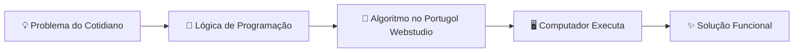
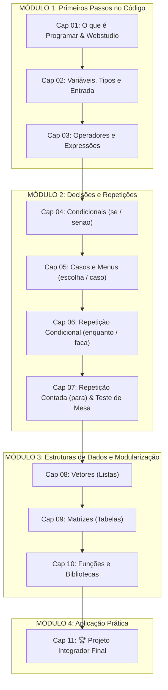

# 🚀 Trilha Autodidata de Lógica de Programação com Portugol Webstudio

> **Aprenda a programar do absoluto zero**, no seu próprio ritmo, direto pelo navegador e sem precisar instalar nada!

[](https://portugol.dev/)
[](#-sumário-do-curso)
[](#)
[](#)

---

## 🎯 Sobre o Curso

Este curso foi desenhado especialmente para quem **nunca escreveu uma única linha de código na vida**. Em vez de começar com linguagens complexas cheias de regras em inglês (como Java, C ou Python), você aprenderá o mais importante primeiro: **a pensar como uma pessoa programadora**.

Para isso, utilizamos o **Portugol**, uma pseudolinguagem em língua portuguesa, executada diretamente no navegador pelo [Portugol Webstudio (portugol.dev)](https://portugol.dev/).



---

## 🗺️ Mapa da Trilha de Aprendizado



---

## 🧭 Sumário do Curso

| Cap. | Tópico | O que você vai dominar | Dificuldade | Arquivo |
| :---: | :--- | :--- | :---: | :---: |
| **00** | ⚡ **Guia Rápido** | Resumo de sintaxe e cola de comandos para consulta | Todas | [Acessar Guia](guia-rapido-portugol.md) |
| **01** | 🚀 **Introdução & Portugol** | Algoritmos, console, `escreva()` e a interface web | 🟢 Fácil | [Capítulo 01](capitulos/01-introducao-e-portugol-webstudio.md) |
| **02** | 📦 **Variáveis & Entrada** | Memória, tipos (`inteiro`, `real`, `cadeia`, `logico`) e `leia()` | 🟢 Fácil | [Capítulo 02](capitulos/02-variaveis-tipos-e-entrada-de-dados.md) |
| **03** | 🧮 **Operadores & Lógica** | Cálculos (`+`, `-`, `*`, `/`, `%`), comparações e operadores `e`/`ou` | 🟢 Fácil | [Capítulo 03](capitulos/03-operadores-aritmeticos-relacionais-e-logicos.md) |
| **04** | 🔀 **Condicionais (se / senao)** | Tomada de decisões simples, compostas e encadeadas | 🟡 Médio | [Capítulo 04](capitulos/04-estruturas-condicionais-se-senao.md) |
| **05** | 🎛️ **Múltipla Escolha** | Menus interativos, estrutura `escolha / caso / pare` | 🟡 Médio | [Capítulo 05](capitulos/05-multipla-escolha-escolha-caso.md) |
| **06** | 🔁 **Laços (enquanto / faca)** | Repetições, contadores, acumuladores e validação | 🟡 Médio | [Capítulo 06](capitulos/06-lacos-de-repeticao-enquanto-faca.md) |
| **07** | 🔢 **Laço Contado & Mesa** | Loop `para`, tabuadas e a técnica do Teste de Mesa | 🟡 Médio | [Capítulo 07](capitulos/07-laco-contado-para-e-teste-de-mesa.md) |
| **08** | 📋 **Vetores (Listas)** | Coleções unidimensionais, índices base-0 e buscas | 🔴 Desafio | [Capítulo 08](capitulos/08-vetores-listas-unidimensionais.md) |
| **09** | 🗄️ **Matrizes (Tabelas)** | Estruturas bidimensionais (linhas $\times$ colunas) e tabuleiros | 🔴 Desafio | [Capítulo 09](capitulos/09-matrizes-tabelas-bidimensionais.md) |
| **10** | 🧩 **Funções & Escopo** | Modularização, parâmetros, retorno e bibliotecas | 🔴 Desafio | [Capítulo 10](capitulos/10-funcoes-escopo-e-bibliotecas.md) |
| **11** | 🏆 **Projeto Final Integrador** | Sistema de Gestão de Estoque e Jogo da Velha completo | 🏆 Master | [Capítulo 11](capitulos/11-projeto-final-integrador.md) |

---

## 🛠️ Como Estudar Sozinho (Manual do Autodidata)

Aprender programação por conta própria é uma habilidade incrível. Para que seu aprendizado seja eficiente e duradouro, siga este método:

### 1. Digite com os próprios dedos, nunca dê Copiar e Colar
> [!IMPORTANT]
> Copiar e colar gera uma ilusão de aprendizado. Ao digitar cada caractere, seu cérebro desenvolve memória muscular e você aprende a prestar atenção em detalhes como ponto e vírgula, chaves e aspas.

### 2. A Regra dos 15 Minutos
> [!TIP]
> Quando um exercício parecer difícil, tente resolver por pelo menos 15 minutos antes de abrir a dica ou o gabarito. Se errar, leia atentamente a mensagem no console do Portugol Webstudio. A arte de programar é 70% entender e corrigir erros.

### 3. Sempre Use o Teste de Mesa
> [!NOTE]
> Quando seu código não fizer o que você esperava, pegue papel e caneta (ou use o editor de texto) e anote os valores de cada variável linha por linha. O computador é 100% previsível: ele só faz exatamente o que você mandou.

### 4. Como Usar os Gabaritos
Cada capítulo conta com **6 atividades práticas progressivas**. As soluções estão ocultas dentro de blocos expansíveis:

<details>
<summary>👀 Clique aqui para ver como os gabaritos aparecem nos capítulos</summary>

```portugol
programa {
    funcao inicio() {
        escreva("Parabéns por tentar antes de olhar a solução! 🎉")
    }
}
```

Cada gabarito traz uma explicação linha a linha de por que aquela solução funciona.
</details>

---

## 💻 Como Acessar o Portugol Webstudio

1. Abra seu navegador (Chrome, Edge, Firefox, Safari ou Brave).
2. Acesse: **[https://portugol.dev/](https://portugol.dev/)**.
3. Clique em **"Novo Arquivo"** ou simplesmente comece a digitar no editor central.
4. Clique no botão verde de **Executar** (ou aperte `Shift + F6`) para rodar seu algoritmo e ver o resultado na aba Console.

---

## 📂 Códigos de Exemplo Prontos (`exemplos/`)

Todos os exemplos principais do curso foram disponibilizados como arquivos `.por` prontos na pasta [`exemplos/`](exemplos/). Você pode abri-los diretamente no Portugol Webstudio para testes imediatos:

- [`exemplos/cap01_ola_mundo.por`](exemplos/cap01_ola_mundo.por)
- [`exemplos/cap02_variaveis_entrada.por`](exemplos/cap02_variaveis_entrada.por)
- [`exemplos/cap03_operadores.por`](exemplos/cap03_operadores.por)
- [`exemplos/cap04_condicionais_se.por`](exemplos/cap04_condicionais_se.por)
- [`exemplos/cap05_menu_escolha.por`](exemplos/cap05_menu_escolha.por)
- [`exemplos/cap06_lacos_enquanto.por`](exemplos/cap06_lacos_enquanto.por)
- [`exemplos/cap07_laco_para_tabuada.por`](exemplos/cap07_laco_para_tabuada.por)
- [`exemplos/cap08_vetores_notas.por`](exemplos/cap08_vetores_notas.por)
- [`exemplos/cap09_matrizes_tabuleiro.por`](exemplos/cap09_matrizes_tabuleiro.por)
- [`exemplos/cap10_funcoes_util.por`](exemplos/cap10_funcoes_util.por)
- [`exemplos/cap11_projeto_estoque.por`](exemplos/cap11_projeto_estoque.por)
- [`exemplos/cap11_projeto_jogo_da_velha.por`](exemplos/cap11_projeto_jogo_da_velha.por)

---

## 📝 Checklist de Progresso Pessoal

Marque suas conquistas à medida que avança na jornada:

- [ ] **Capítulo 01**: Entendi o que é algoritmo e criei meu primeiro programa no Portugol Webstudio.
- [ ] **Capítulo 02**: Sei guardar dados em variáveis e pedir dados ao usuário com `leia()`.
- [ ] **Capítulo 03**: Sei fazer contas matemáticas, usar `%` e combinar condições com `e`/`ou`.
- [ ] **Capítulo 04**: Meu programa já sabe tomar decisões com `se` e `senao`.
- [ ] **Capítulo 05**: Construí meu primeiro menu interativo com `escolha / caso`.
- [ ] **Capítulo 06**: Entendi como criar repetições com `enquanto` e evitar loops infinitos.
- [ ] **Capítulo 07**: Domino o laço `para` e sei fazer um Teste de Mesa no papel.
- [ ] **Capítulo 08**: Sei armazenar vários dados em um `vetor` e percorrê-lo com `para`.
- [ ] **Capítulo 09**: Consigo manipular tabelas bidimensionais com `matrizes`.
- [ ] **Capítulo 10**: Sei criar minhas próprias `funções`, passar parâmetros e retornar valores.
- [ ] **Capítulo 11**: Concluí o Projeto Integrador Final! 🎓

---

**Vamos começar?** Siga agora para o [👉 Capítulo 01: O que é Programar & Portugol Webstudio](capitulos/01-introducao-e-portugol-webstudio.md)!
