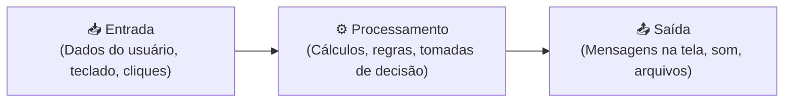

# 🚀 Capítulo 01: O que é Programar & Portugol Webstudio

| 🏠 [Início](../README.md) | ⚡ [Guia Rápido](../guia-rapido-portugol.md) | ➡️ [Próximo: Variáveis e Entrada](02-variaveis-tipos-e-entrada-de-dados.md) |
| :--- | :---: | ---: |

---

## 📋 Informações do Capítulo
- **Tempo estimado de estudo:** 45 minutos
- **Pré-requisitos:** Nenhum! Partimos do absoluto zero.
- **Objetivos de Aprendizagem:**
  1. Compreender o que é um algoritmo e como o computador pensa.
  2. Conhecer a interface do [Portugol Webstudio](https://portugol.dev/).
  3. Escrever e executar seu primeiro programa de computador.
  4. Dominar a exibição de mensagens no console com o comando `escreva()`.

---

## 🍳 1. Analogia do Mundo Real: O Robô Hiper-Literal

Imagine que você comprou um robô doméstico ultra-avançado, mas ele tem uma peculiaridade: **ele não tem bom senso**. Ele faz **exatamente** o que você mandar, sem interpretar nada.

Se você pedir:
> *"Robô, faça um café para mim."*

Ele vai travar! Ele não sabe onde está a água, não sabe onde está o pó, não sabe ligar a cafeteira e não sabe o que é uma xícara.

Para o robô funcionar, você precisa fornecer um **passo a passo detalhado, sem ambiguidades e em ordem lógica**:
1. Pegue a jarra de água.
2. Coloque 500ml de água no reservatório da cafeteira.
3. Pegue um filtro de papel e coloque no suporte.
4. Adicione duas colheres de pó de café.
5. Aperte o botão de ligar.
6. Aguarde 3 minutos.
7. Sirva o café na xícara.

> [!NOTE]
> Essa sequência ordenada de instruções para resolver um problema chama-se **Algoritmo**. Programar nada mais é do que escrever receitas que o computador entende e executa à risca!

---

## 🧠 2. O Ciclo IPO: Entrada, Processamento e Saída

Todo programa do mundo, desde uma calculadora simples até o aplicativo do seu banco, segue três etapas fundamentais:



Neste primeiro capítulo, focaremos na **Saída** (mostrar dados na tela para o usuário). No próximo capítulo, aprenderemos a receber a **Entrada**.

---

## 🖥️ 3. Conhecendo o Portugol Webstudio

O **Portugol** é uma pseudolinguagem em português criada para ensinar programação. O **Portugol Webstudio** roda direto no navegador:

1. Acesse o site oficial: **[portugol.dev](https://portugol.dev/)**.
2. Veja a divisão da tela:
   - **Área Central (Editor de Código):** Onde digitamos nosso programa.
   - **Botão Executar (▶️ verde ou `Shift + F6`):** Inicia a execução do algoritmo.
   - **Painel Inferior (Aba Console):** Onde o programa exibe mensagens e interage com quem está usando.

---

## 💻 4. A Estrutura Básica de um Programa

No Portugol, todo código segue este esqueleto obrigatório:

```portugol
programa {
    funcao inicio() {
        escreva("Olá, Mundo!")
    }
}
```

Vamos dissecar cada parte desse código:

1. `programa { ... }`: Delimita onde começa e onde termina todo o seu projeto.
2. `funcao inicio() { ... }`: É o "ponto de partida". Quando você clica em Executar, o computador procura a função `inicio()` e começa a rodar a partir dali.
3. `escreva("Olá, Mundo!")`: Comando que imprime texto no Console.
4. As **chaves `{` e `}`**: Servem para abrir e fechar blocos de código. Sempre que abrir `{`, é obrigatório fechar com `}`.

> [!IMPORTANT]
> **Aspas Duplas Obrigatórias:** Todo texto literal que deve aparecer exatamente como foi escrito precisa estar envolvido por aspas duplas: `"Assim"`.

---

## 🔤 5. Saltando Linhas com `\n` e Tabulações com `\t`

Observe o que acontece se escrevermos duas linhas seguidas:

```portugol
programa {
    funcao inicio() {
        escreva("Bom dia!")
        escreva("Tudo bem?")
    }
}
```

O console exibirá: `Bom dia!Tudo bem?` (tudo grudado!).

Para pular de linha, usamos o caractere especial **`\n`** (barra invertida + letra n, de *new line*):

```portugol
programa {
    funcao inicio() {
        escreva("Bom dia!\n")
        escreva("Tudo bem?\n")
    }
}
```

Agora sim o resultado será:
```text
Bom dia!
Tudo bem?
```

> [!TIP]
> Se quiser dar um espaço de tabulação (como a tecla Tab), use **`\t`**:
> `escreva("Nome:\tCarlos\nIdade:\t25\n")`

---

## 🔍 6. Teste de Mesa Guiado

O **Teste de Mesa** é a simulação mental do que o computador faz linha por linha.

Considere o código:
```portugol
1: programa {
2:     funcao inicio() {
3:         escreva("Passo 1\n")
4:         escreva("Passo 2\n")
5:         escreva("Passo 3\n")
6:     }
7: }
```

| Linha | Ação do Computador | Saída no Console |
| :---: | :--- | :--- |
| **1-2** | Inicia a execução do programa | *(vazio)* |
| **3** | Escreve "Passo 1" e quebra a linha | `Passo 1` |
| **4** | Escreve "Passo 2" e quebra a linha | `Passo 1`<br>`Passo 2` |
| **5** | Escreve "Passo 3" e quebra a linha | `Passo 1`<br>`Passo 2`<br>`Passo 3` |
| **6-7** | Fim do programa | Programa finalizado. |

---

## ⚠️ 7. Erros Comuns de Quem Está Começando

1. **Esquecer as aspas duplas:**
   - ❌ `escreva(Olá mundo)` $\rightarrow$ O Portugol pensará que `Olá` é uma variável desconhecida e dará erro de sintaxe.
   - ✅ `escreva("Olá mundo")`

2. **Trocar maiúsculas por minúsculas:**
   - O Portugol diferencia maiúsculas de minúsculas (*case-sensitive*).
   - ❌ `Escreva("Teste")` ou `PROGRAMA {`
   - ✅ `escreva("Teste")` e `programa {`

3. **Chaves desemparelhadas:**
   - Se você abriu duas chaves `{{`, precisa fechar duas chaves `}}`. Verifique sempre o alinhamento das chaves!

---

## 🏋️ 8. Laboratório de Atividades Práticas

Resolva os exercícios diretamente no [Portugol Webstudio](https://portugol.dev/). Tente fazer sozinho antes de olhar a solução!

---

### 🟢 Atividade 1 (Fixação): O Primeiro "Olá, Mundo!"
Crie um programa que exiba a clássica mensagem de boas-vindas:
```text
Olá, Mundo da Programação!
Estou aprendendo Portugol Webstudio.
```

<details>
<summary>💡 Dica</summary>

Lembre-se de usar `\n` ao final de cada frase para que o segundo texto vá para a linha de baixo.
</details>

<details>
<summary>✅ Ver Solução Comentada</summary>

```portugol
programa {
    funcao inicio() {
        escreva("Olá, Mundo da Programação!\n")
        escreva("Estou aprendendo Portugol Webstudio.\n")
    }
}
```
**Explicação:** O primeiro `escreva` imprime a frase e o `\n` garante que o cursor vá para a próxima linha antes de imprimir a segunda frase.
</details>

---

### 🟢 Atividade 2 (Fixação): Cartão de Visitas no Console
Crie um programa que imprima na tela o seu "cartão de visitas digital" com seu nome, sua cidade e seu principal objetivo com a programação. Formate com bordas usando caracteres como `-` ou `=`.

<details>
<summary>💡 Dica</summary>

Você pode usar várias linhas com `escreva("==============================\n")` para criar uma moldura visual bonita.
</details>

<details>
<summary>✅ Ver Solução Comentada</summary>

```portugol
programa {
    funcao inicio() {
        escreva("=========================================\n")
        escreva("|           CARTÃO DE VISITAS           |\n")
        escreva("=========================================\n")
        escreva("| Nome:     Dev Aprendiz                |\n")
        escreva("| Cidade:   São Paulo - SP              |\n")
        escreva("| Objetivo: Dominar lógica em 2026!     |\n")
        escreva("=========================================\n")
    }
}
```
**Explicação:** O alinhamento dos espaços dentro das aspas é mantido exatamente na tela do console, criando um efeito de caixa/tabela.
</details>

---

### 🟡 Atividade 3 (Prática Contextualizada): Receita do Bolo Algorítmica
Escreva um programa que imprima na tela um algoritmo passo a passo para fazer um miojo ou um bolo simples, enumerando os passos de 1 a 5 de forma organizada.

<details>
<summary>💡 Dica</summary>

Use quebras de linha `\n` entre cada passo para que a receita fique fácil de ler.
</details>

<details>
<summary>✅ Ver Solução Comentada</summary>

```portugol
programa {
    funcao inicio() {
        escreva("--- RECEITA DE MIOJO (ALGORITMO) ---\n")
        escreva("1. Ferva 450ml de água em uma panela.\n")
        escreva("2. Coloque o macarrão e cozinhe por 3 minutos.\n")
        escreva("3. Apague o fogo.\n")
        escreva("4. Misture o tempero suavemente.\n")
        escreva("5. Sirva em um prato fundo e aproveite!\n")
    }
}
```
**Explicação:** Cada linha representa uma instrução sequencial executada rigorosamente do topo para a base pelo computador.
</details>

---

### 🟡 Atividade 4 (Prática Contextualizada): Arte em Texto (ASCII Art)
Desenhe uma casinha ou uma árvore simples utilizando apenas caracteres do teclado (`/`, `\`, `_`, `|`, `*`).

<details>
<summary>💡 Dica</summary>

Tenha cuidado ao desenhar barras. Use espaços para empurrar as partes do telhado e das paredes.
</details>

<details>
<summary>✅ Ver Solução Comentada</summary>

```portugol
programa {
    funcao inicio() {
        escreva("   /\\   \n")
        escreva("  /  \\  \n")
        escreva(" /____\\ \n")
        escreva(" | [] | \n")
        escreva(" |    | \n")
        escreva(" ------ \n")
    }
}
```
**Explicação:** Ao desenhar caracteres no console, cada espaço em branco conta para o alinhamento visual.
</details>

---

### 🐛 Atividade 5 (Caça-Bugs): O Código com 3 Erros
Um colega tentou rodar o código abaixo no Portugol Webstudio e recebeu mensagens de erro. Encontre os **3 erros**, corrija-os e faça o programa funcionar:

```portugol
// CÓDIGO COM DEFEITO:
programa {
    Funcao inicio() {
        escreva("Bem-vindo ao curso!\n)
        escreva(Vamos aprender lógica juntos!)
    }
```

<details>
<summary>💡 Dica</summary>

Analise:
1. Como a palavra `funcao` foi escrita?
2. O que falta fechar na linha 4?
3. O que falta no texto da linha 5?
4. Quantas chaves `{` foram abertas e quantas foram fechadas?
</details>

<details>
<summary>✅ Ver Solução Comentada</summary>

```portugol
// CÓDIGO CORRIGIDO:
programa {
    funcao inicio() {
        escreva("Bem-vindo ao curso!\n")
        escreva("Vamos aprender lógica juntos!\n")
    }
}
```
**Quais eram os erros?**
1. `Funcao` com F maiúsculo (deve ser `funcao` minúsculo).
2. Na linha 4 faltava fechar as aspas duplas antes do parêntese (`"Bem-vindo ao curso!\n"`).
3. Na linha 5 o texto estava sem aspas duplas (`"Vamos aprender lógica juntos!\n"`).
4. Faltava fechar a chave final do `programa {`.
</details>

---

### 🔴 Atividade 6 (Desafio): Menu Inicial de um Jogo Textual
Crie a tela de abertura de um jogo retrô de aventura em modo texto. O programa deve exibir:
- O título do jogo bem chamativo com moldura.
- Três opções: `[1] Novo Jogo`, `[2] Carregar Jogo`, `[3] Sair`.
- Uma mensagem no final: `"Escolha uma opção digitando o número correspondente:"`.

<details>
<summary>💡 Dica</summary>

Ainda não sabemos ler a resposta do usuário (aprenderemos no Capítulo 02 com o `leia`), então por enquanto apenas desenhe a tela de apresentação perfeitamente formatada!
</details>

<details>
<summary>✅ Ver Solução Comentada</summary>

```portugol
programa {
    funcao inicio() {
        escreva("########################################\n")
        escreva("#                                      #\n")
        escreva("#     A JORNADA DO GUERREIRO PORTUGOL  #\n")
        escreva("#                                      #\n")
        escreva("########################################\n\n")

        escreva("  [1] Iniciar Nova Aventura\n")
        escreva("  [2] Continuar Jogo Salvo\n")
        escreva("  [3] Créditos e Instruções\n")
        escreva("  [4] Sair\n\n")

        escreva("========================================\n")
        escreva("Digite o número da sua escolha: _\n")
    }
}
```
**Explicação:** Usar quebras de linha duplas `\n\n` cria espaçamentos elegantes entre seções visuais.
</details>

---

## 🎯 Autoavaliação do Capítulo 01

Antes de ir para o próximo capítulo, confirme se você é capaz de:
- [ ] Explicar o que é um algoritmo usando suas próprias palavras.
- [ ] Abrir o [Portugol Webstudio](https://portugol.dev/) e criar um programa com `programa` e `funcao inicio()`.
- [ ] Usar o `escreva()` com aspas duplas e quebrar linhas com `\n`.
- [ ] Encontrar e corrigir erros de chaves desemparelhadas e maiúsculas indevidas.

---

| 🏠 [Início](../README.md) | ⚡ [Guia Rápido](../guia-rapido-portugol.md) | ➡️ [Próximo: Variáveis e Entrada](02-variaveis-tipos-e-entrada-de-dados.md) |
| :--- | :---: | ---: |

