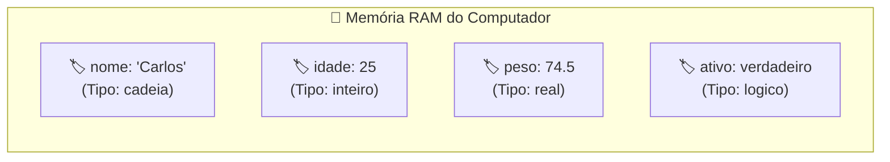
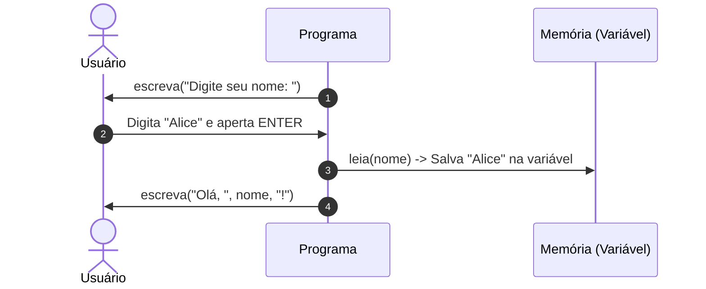

# 📦 Capítulo 02: Variáveis, Tipos de Dados e Entrada do Usuário

| ⬅️ [Anterior: O que é Programar](01-introducao-e-portugol-webstudio.md) | 🏠 [Início](../README.md) | ⚡ [Guia Rápido](../guia-rapido-portugol.md) | ➡️ [Próximo: Operadores](03-operadores-aritmeticos-relacionais-e-logicos.md) |
| :--- | :---: | :---: | ---: |

---

## 📋 Informações do Capítulo
- **Tempo estimado de estudo:** 60 minutos
- **Pré-requisitos:** [Capítulo 01](01-introducao-e-portugol-webstudio.md).
- **Objetivos de Aprendizagem:**
  1. Entender o que é uma variável e como funciona a memória RAM.
  2. Conhecer e aplicar os 4 tipos fundamentais de dados do Portugol (`inteiro`, `real`, `cadeia`, `logico`).
  3. Receber dados digitados pelo usuário via teclado com `leia()`.
  4. Exibir textos e variáveis combinados no console usando concatenação.

---

## 📦 1. Analogia do Mundo Real: As Caixas Etiquetadas

Imagine que você está organizando uma mudança e tem dezenas de **caixas de papelão**:
- Uma caixa com a etiqueta **"Livros"** só guarda livros.
- Uma caixa com a etiqueta **"Roupas"** só guarda roupas.
- Se você colocar uma nova roupa dentro da caixa, o conteúdo anterior é atualizado.

No computador, as **variáveis** são exatamente como essas caixas na memória RAM:
- Cada variável tem um **Nome** (o rótulo da caixa, ex: `idade`).
- Cada variável tem um **Tipo** (o formato do que cabe nela, ex: só números inteiros).
- Cada variável guarda um **Valor** temporário (o conteúdo atual dentro dela).



---

## 🏷️ 2. Os Tipos Primitivos no Portugol

O Portugol é uma linguagem **fortemente tipada**. Isso significa que você precisa avisar ao computador com antecedência que tipo de dado cada variável vai guardar.

| Tipo | O que aceita | Exemplo do cotidiano | Sintaxe no Portugol |
| :--- | :--- | :--- | :--- |
| `inteiro` | Números inteiros (sem vírgula) | Quantidade de filhos, ano, idade | `inteiro idade = 18` |
| `real` | Números com casas decimais (ponto) | Salário, peso, altura, preço | `real preco = 49.90` |
| `cadeia` | Frases, palavras, textos em geral | Nome, e-mail, cidade, telefone | `cadeia nome = "Beatriz"` |
| `caracter` | Apenas UM único caractere | Gênero (`'M'`), opção (`'S'`) | `caracter opcao = 'S'` |
| `logico` | Verdadeiro ou falso (booleano) | Lâmpada ligada, usuário logado | `logico ativo = verdadeiro` |

> [!IMPORTANT]
> - Em números decimais (`real`), usamos **ponto (`.`)** e nunca vírgula! Exemplo: `75.8`.
> - Textos do tipo `cadeia` usam sempre **aspas duplas**: `"Olá"`.
> - Um único caractere do tipo `caracter` usa **aspas simples**: `'A'`.

---

## ✍️ 3. Regras para Dar Nomes às Variáveis

Para evitar confusões no computador, siga estas regras:
1. **Comece sempre com letra minúscula:** `idade`, `nomeAluno`, `precoFinal`.
2. **Não use espaços:** em vez de `preco do produto`, use `precoDoProduto` (padrão camelCase) ou `preco_do_produto`.
3. **Não use caracteres especiais nem acentos:** evite `preço`, `número`, `endereço`. Prefira `preco`, `numero`, `endereco`.
4. **Não comece com números:** `1nome` é proibido; `nome1` é permitido.
5. **Não use palavras reservadas:** você não pode nomear uma variável como `programa`, `funcao`, `inteiro` ou `escreva`.

---

## 📥 4. Entrada de Dados com `leia()`

Até agora, nossos programas eram "mudos": nós já deixávamos os textos fixos. Agora, o programa vai **conversar** com a pessoa usuária!

O comando **`leia(nomeDaVariavel)`** faz o programa pausar a execução, esperar o usuário digitar algo no teclado e teclar `Enter`. Quando isso acontece, o valor digitado vai direto para dentro da variável!



---

## 🔗 5. Concatenação: Juntando Texto com Variáveis

Para exibir uma mensagem combinando textos fixos com os valores das variáveis, separamos cada elemento por uma **vírgula `,`** dentro do `escreva()`:

```portugol
programa {
    funcao inicio() {
        cadeia nome
        inteiro idade

        escreva("Qual é o seu nome? ")
        leia(nome)

        escreva("Qual é a sua idade? ")
        leia(idade)

        // Concatenação de texto e variáveis
        escreva("\nPrazer em te conhecer, ", nome, "! Você tem ", idade, " anos.\n")
    }
}
```

> [!TIP]
> Observe o espaço antes e depois das aspas em `", nome, "! Você tem "`. Se você não colocar esses espaços, o texto sairá grudado: `Beatriz!Você tem 20anos.`

---

## 🔍 6. Teste de Mesa Guiado: Acompanhando a Memória

Observe como as variáveis nascem e mudam a cada linha:

```portugol
1: programa {
2:     funcao inicio() {
3:         inteiro a = 10
4:         inteiro b = 20
5:         inteiro soma
6:         soma = a + b
7:         a = 99
8:     }
9: }
```

| Linha | Variável `a` | Variável `b` | Variável `soma` | Ação do Computador |
| :---: | :---: | :---: | :---: | :--- |
| **3** | `10` | *(indefinido)* | *(indefinido)* | Reserva espaço para `a` com valor 10 |
| **4** | `10` | `20` | *(indefinido)* | Reserva espaço para `b` com valor 20 |
| **5** | `10` | `20` | `0` | Declara `soma` |
| **6** | `10` | `20` | `30` | Calcula `10 + 20` e atribui a `soma` |
| **7** | `99` | `20` | `30` | Sobrescreve `a` com 99 (`soma` continua 30!) |

---

## ⚠️ 7. Erros Comuns

1. **Incompatibilidade de Tipos:**
   - Declarar `inteiro valor` e tentar guardar `"Texto"` ou `10.5`. O Portugol gerará um erro.
2. **Esquecer de avisar o usuário antes do `leia()`:**
   - Se você colocar `leia(idade)` sem um `escreva("Digite sua idade: ")` antes, o console ficará com a tela preta piscando e o usuário não saberá o que fazer!
3. **Usar vírgula em vez de ponto em números decimais:**
   - ❌ `real altura = 1,75`
   - ✅ `real altura = 1.75`

---

## 🏋️ 8. Laboratório de Atividades Práticas

Execute suas soluções no [Portugol Webstudio](https://portugol.dev/).

---

### 🟢 Atividade 1 (Fixação): Cadastro Interativo Simples
Crie um programa que pergunte o **primeiro nome**, a **idade** e a **altura em metros** (ex: 1.75) de uma pessoa. Em seguida, exiba essas informações formatadas em uma frase amigável.

<details>
<summary>💡 Dica</summary>

- `nome` deve ser `cadeia`
- `idade` deve ser `inteiro`
- `altura` deve ser `real`
</details>

<details>
<summary>✅ Ver Solução Comentada</summary>

```portugol
programa {
    funcao inicio() {
        cadeia nome
        inteiro idade
        real altura

        escreva("Digite seu nome: ")
        leia(nome)

        escreva("Digite sua idade: ")
        leia(idade)

        escreva("Digite sua altura em metros (use ponto, ex 1.75): ")
        leia(altura)

        escreva("\n--- DADOS CADASTRADOS ---\n")
        escreva("Nome: ", nome, "\n")
        escreva("Idade: ", idade, " anos\n")
        escreva("Altura: ", altura, " m\n")
    }
}
```
**Explicação:** Cada variável guarda o dado do seu tipo correto e depois o `escreva` concatena rótulo e valor.
</details>

---

### 🟢 Atividade 2 (Fixação): O Desafio dos Dois Copos (Troca de Valores)
Imagine dois copos: um copo A com suco de laranja e um copo B com refrigerante. Como trocar o conteúdo dos dois copos sem misturá-los? Você precisa de um **terceiro copo auxiliar**!
No Portugol, crie duas variáveis: `copoA = "Laranja"` e `copoB = "Refrigerante"`. Faça com que `copoA` passe a conter `"Refrigerante"` e `copoB` passe a conter `"Laranja"`, usando uma terceira variável `auxiliar`.

<details>
<summary>💡 Dica</summary>

1. Guarde o valor do `copoA` no `auxiliar`.
2. Coloque o valor do `copoB` dentro do `copoA`.
3. Coloque o valor do `auxiliar` dentro do `copoB`.
</details>

<details>
<summary>✅ Ver Solução Comentada</summary>

```portugol
programa {
    funcao inicio() {
        cadeia copoA = "Laranja"
        cadeia copoB = "Refrigerante"
        cadeia auxiliar

        escreva("Antes da troca:\n")
        escreva("Copo A: ", copoA, " | Copo B: ", copoB, "\n\n")

        // Algoritmo clássico de troca (SWAP)
        auxiliar = copoA
        copoA = copoB
        copoB = auxiliar

        escreva("Depois da troca:\n")
        escreva("Copo A: ", copoA, " | Copo B: ", copoB, "\n")
    }
}
```
**Explicação:** Sem a variável `auxiliar`, se fizéssemos direto `copoA = copoB`, o suco de laranja original seria apagado da memória para sempre!
</details>

---

### 🟡 Atividade 3 (Prática Contextualizada): Ficha de Personagem de RPG
Crie um gerador de ficha para um jogo de videogame. O programa deve pedir:
- Nome do herói (`cadeia`)
- Classe (Guerreiro, Mago, Arqueiro) (`cadeia`)
- Nível inicial (`inteiro`)
- Pontos de Vida (HP) (`real`)
- Possui escudo mágico? (`logico` - o usuário deve digitar `verdadeiro` ou `falso`)

Ao final, mostre a ficha estilizada com bordas no console.

<details>
<summary>💡 Dica</summary>

Para variáveis do tipo `logico`, o usuário digita no console exatamente a palavra `verdadeiro` ou `falso`.
</details>

<details>
<summary>✅ Ver Solução Comentada</summary>

```portugol
programa {
    funcao inicio() {
        cadeia heroi, classe
        inteiro nivel
        real vida
        logico escudo

        escreva("=== CRIADOR DE PERSONAGEM ===\n")
        escreva("Nome do Herói: ")
        leia(heroi)

        escreva("Classe: ")
        leia(classe)

        escreva("Nível (ex: 1): ")
        leia(nivel)

        escreva("Pontos de Vida Máximos: ")
        leia(vida)

        escreva("Possui escudo mágico? (digite verdadeiro ou falso): ")
        leia(escudo)

        escreva("\n====================================\n")
        escreva("FICHA DO JOGADOR: ", heroi, "\n")
        escreva("Classe: ", classe, " | Nível: ", nivel, "\n")
        escreva("HP: ", vida, " pts\n")
        escreva("Escudo Equipado: ", escudo, "\n")
        escreva("====================================\n")
    }
}
```
</details>

---

### 🟡 Atividade 4 (Prática Contextualizada): Dobro e Triplo
Crie um programa que leia um número inteiro digitado pelo usuário e armazene em variáveis distintas:
1. O dobro do número (`numero * 2`)
2. O triplo do número (`numero * 3`)
Ao final, mostre o número original, o seu dobro e o seu triplo.

<details>
<summary>💡 Dica</summary>

Declare três variáveis do tipo `inteiro`: `num`, `dobro` e `triplo`.
</details>

<details>
<summary>✅ Ver Solução Comentada</summary>

```portugol
programa {
    funcao inicio() {
        inteiro num, dobro, triplo

        escreva("Digite um número inteiro: ")
        leia(num)

        dobro = num * 2
        triplo = num * 3

        escreva("\nNúmero digitado: ", num, "\n")
        escreva("O dobro é: ", dobro, "\n")
        escreva("O triplo é: ", triplo, "\n")
    }
}
```
</details>

---

### 🐛 Atividade 5 (Caça-Bugs): O Erro de Tipagem
Veja o código com erros abaixo. Ele não compila no Portugol Webstudio. Identifique os problemas e conserte-o:

```portugol
// CÓDIGO COM ERRO:
programa {
    funcao inicio() {
        inteiro preco = 19.90
        cadeia idade
        escreva("Digite sua idade: ")
        leia(idade)
        
        escreva("Ano que vem você terá: " + (idade + 1))
    }
}
```

<details>
<summary>💡 Dica</summary>

1. `19.90` tem casas decimais. Qual deve ser o tipo de `preco`?
2. `idade` será usada para uma conta matemática (`+ 1`). Ela pode ser `cadeia`?
3. No Portugol, concatenamos variáveis no `escreva` usando vírgula `,` e não o sinal `+`.
</details>

<details>
<summary>✅ Ver Solução Comentada</summary>

```portugol
// CÓDIGO CORRIGIDO:
programa {
    funcao inicio() {
        real preco = 19.90
        inteiro idade
        inteiro idadeAnoQueVem

        escreva("Digite sua idade: ")
        leia(idade)

        idadeAnoQueVem = idade + 1
        escreva("Ano que vem você terá: ", idadeAnoQueVem, " anos.\n")
    }
}
```
**O que foi corrigido?**
- `preco` passou de `inteiro` para `real`.
- `idade` passou de `cadeia` para `inteiro`, permitindo a soma.
- A concatenação passou a usar vírgula `,`.
</details>

---

### 🔴 Atividade 6 (Desafio): Simulador de Recibo de Loja
Crie um programa que simule a frente de caixa de uma papelaria. Ele deve:
1. Ler o nome do produto (ex: `"Caderno Universitário"`).
2. Ler a quantidade comprada (`inteiro`, ex: `3`).
3. Ler o preço unitário (`real`, ex: `15.50`).
4. Calcular o total a pagar (`quantidade * precoUnitario`).
5. Imprimir um cupom fiscal organizado com bordas.

<details>
<summary>💡 Dica</summary>

Multiplique a quantidade inteira pelo preço real. O resultado deve ser guardado em uma variável do tipo `real`.
</details>

<details>
<summary>✅ Ver Solução Comentada</summary>

```portugol
programa {
    funcao inicio() {
        cadeia produto
        inteiro quantidade
        real precoUnitario
        real valorTotal

        escreva("--- SISTEMA DE CAIXA ---\n")
        escreva("Nome do produto: ")
        leia(produto)

        escreva("Quantidade: ")
        leia(quantidade)

        escreva("Preço unitário (R$): ")
        leia(precoUnitario)

        valorTotal = quantidade * precoUnitario

        escreva("\n=========================================\n")
        escreva("             CUPOM FISCAL               \n")
        escreva("=========================================\n")
        escreva("Item:       ", produto, "\n")
        escreva("Qtd:        ", quantidade, " un\n")
        escreva("Unitário:   R$ ", precoUnitario, "\n")
        escreva("-----------------------------------------\n")
        escreva("TOTAL:      R$ ", valorTotal, "\n")
        escreva("=========================================\n")
        escreva("Obrigado pela preferência e volte sempre!\n")
    }
}
```
</details>

---

## 🎯 Autoavaliação do Capítulo 02

Antes de avançar, certifique-se de que consegue:
- [ ] Explicar a diferença entre `inteiro`, `real`, `cadeia` e `logico`.
- [ ] Declarar variáveis e atribuir valores com `=`.
- [ ] Ler valores digitados pelo usuário com `leia()`.
- [ ] Combinar textos e variáveis com vírgula no `escreva()`.

---

| ⬅️ [Anterior: O que é Programar](01-introducao-e-portugol-webstudio.md) | 🏠 [Início](../README.md) | ⚡ [Guia Rápido](../guia-rapido-portugol.md) | ➡️ [Próximo: Operadores](03-operadores-aritmeticos-relacionais-e-logicos.md) |
| :--- | :---: | :---: | ---: |

