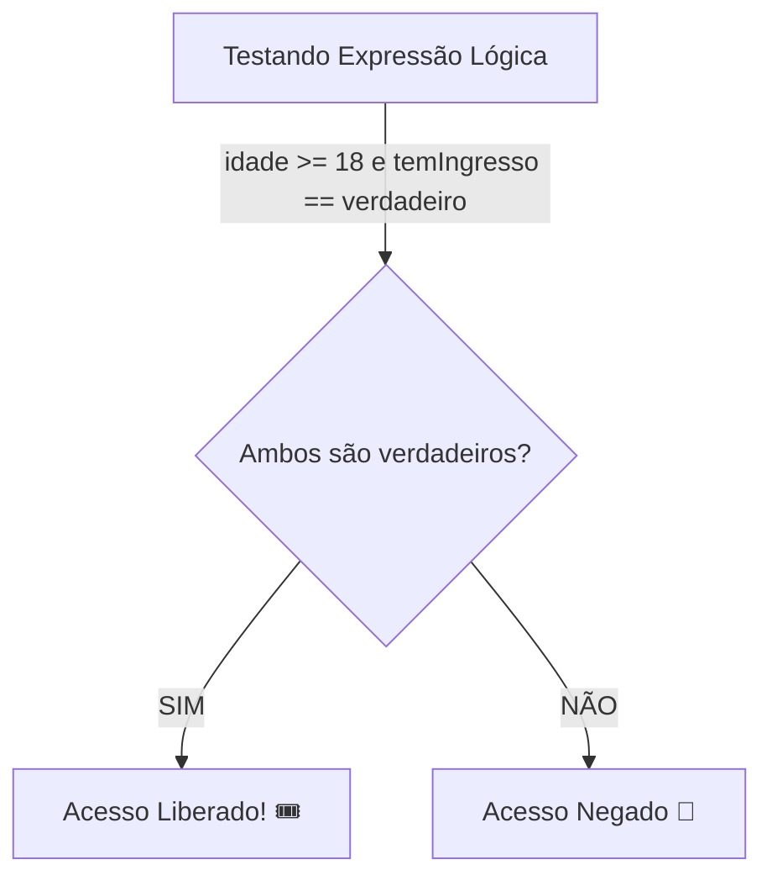

# 🧮 Capítulo 03: Operadores Aritméticos, Relacionais e Lógicos

| ⬅️ [Anterior: Variáveis e Entrada](02-variaveis-tipos-e-entrada-de-dados.md) | 🏠 [Início](../README.md) | ⚡ [Guia Rápido](../guia-rapido-portugol.md) | ➡️ [Próximo: Condicionais se/senao](04-estruturas-condicionais-se-senao.md) |
| :--- | :---: | :---: | ---: |

---

## 📋 Informações do Capítulo
- **Tempo estimado de estudo:** 60 minutos
- **Pré-requisitos:** [Capítulo 02](02-variaveis-tipos-e-entrada-de-dados.md).
- **Objetivos de Aprendizagem:**
  1. Realizar cálculos matemáticos completos (`+`, `-`, `*`, `/`, `%`) no Portugol.
  2. Entender a diferença crucial entre divisão inteira e divisão real.
  3. Fazer comparações numéricas com operadores relacionais (`==`, `!=`, `>`, `<`, etc.).
  4. Construir raciocínios lógicos combinados usando `e`, `ou` e `nao`.

---

## ⚖️ 1. Analogia do Mundo Real: Tirando a Carteira de Motorista

Pense nas regras para alguém tirar a CNH (Carteira Nacional de Habilitação) no Brasil:
1. A pessoa precisa ter **18 anos ou mais** (`idade >= 18`).
2. E a pessoa precisa ser **aprovada no exame médico** (`exameMedico == verdadeiro`).
3. E a pessoa precisa ser **aprovada na prova teórica** (`provaTeorica >= 70`).

Para você ser motorista habilitado, basta cumprir apenas um desses itens? **Não!** É necessário que **TODAS** as condições sejam verdadeiras simultaneamente. Esse "E" é exatamente o operador lógico `e` da programação!

Agora pense no pagamento da conta no mercado:
> *"Você pode pagar com Cartão de Crédito **OU** Dinheiro **OU** Pix."*

Neste caso, basta que **UMA** das formas de pagamento seja válida para a compra ser aprovada. Esse é o operador lógico `ou`.

---

## ➕ 2. Operadores Aritméticos

```portugol
inteiro a = 10, b = 3
inteiro soma = a + b        // 13
inteiro subtracao = a - b   // 7
inteiro multiplicacao = a * b // 30
inteiro divisao = a / b     // 3 (atenção à divisão inteira!)
inteiro resto = a % b       // 1 (o resto de 10 dividido por 3)
```

### ⚠️ O Segredo da Divisão no Portugol
> [!WARNING]
> Quando você divide dois números do tipo `inteiro`, o Portugol joga fora as casas decimais!
> - `5 / 2` resulta em **`2`** (ele trunca o `.5`!).
> - Para obter `2.5`, pelo menos um dos números deve ser do tipo `real`:
>   `5.0 / 2.0` resulta em **`2.5`**.

### 💡 O Poder do Operador Módulo (`%`)
O operador `%` calcula o **resto da divisão inteira**. Ele é muito usado para:
1. **Saber se um número é Par ou Ímpar:** se `numero % 2 == 0`, ele é par; se `numero % 2 == 1`, é ímpar!
2. **Saber se um número é múltiplo de outro:** se `ano % 4 == 0`, o ano é divisível por 4.
3. **Converter unidades de tempo:** transformar segundos em minutos e horas.

---

## 📐 3. Ordem de Precedência (PEMDAS)

O computador segue rigorosamente as regras da matemática:
1. Parênteses `( )` são calculados primeiro.
2. Multiplicação `*`, Divisão `/` e Resto `%` têm prioridade média.
3. Adição `+` e Subtração `-` são calculadas por último.

```portugol
// ERRADO para calcular média:
real media = 7.0 + 8.0 / 2.0 // O computador calcula 8.0 / 2.0 = 4.0 primeiro, e depois soma 7.0 = 11.0!

// CORRETO:
real media = (7.0 + 8.0) / 2.0 // Primeiro soma (15.0), depois divide por 2 = 7.5
```

---

## 🔍 4. Operadores Relacionais (Comparações)

Comparam dois valores e sempre geram um resultado do tipo `logico` (`verdadeiro` ou `falso`):

| Operador | Significado | Exemplo | Resultado |
| :---: | :--- | :---: | :---: |
| `==` | Igual a | `10 == 10` | `verdadeiro` |
| `!=` | Diferente de | `10 != 5` | `verdadeiro` |
| `>` | Maior que | `15 > 20` | `falso` |
| `<` | Menor que | `15 < 20` | `verdadeiro` |
| `>=` | Maior ou igual a | `18 >= 18` | `verdadeiro` |
| `<=` | Menor ou igual a | `7 <= 5` | `falso` |

> [!CAUTION]
> Nunca confunda:
> - `=` é **atribuição**: guarda um valor em uma gaveta (`x = 5`).
> - `==` é **comparação**: pergunta se dois valores são iguais (`x == 5`).

---

## 🧠 5. Operadores Lógicos (`e`, `ou`, `nao`)

### Tabela-Verdade Resumida:

| Expressão A | Expressão B | `A e B` (Ambos) | `A ou B` (Pelo menos um) | `nao A` (Inversão) |
| :---: | :---: | :---: | :---: | :---: |
| `verdadeiro` | `verdadeiro` | **`verdadeiro`** | **`verdadeiro`** | `falso` |
| `verdadeiro` | `falso` | `falso` | **`verdadeiro`** | `falso` |
| `falso` | `verdadeiro` | `falso` | **`verdadeiro`** | `verdadeiro` |
| `falso` | `falso` | `falso` | `falso` | `verdadeiro` |



---

## 🔍 6. Teste de Mesa Guiado

Acompanhe as expressões lógicas passo a passo:

```portugol
inteiro idade = 20
real saldo = 150.0
logico podeViajar = (idade >= 18) e (saldo >= 200.0)
logico temDesconto = (idade < 12) ou (idade >= 60)
```

| Expressão | Avaliação Parcial | Resultado Final |
| :--- | :--- | :---: |
| `podeViajar` | `(20 >= 18)` é `verdadeiro`<br>`(150.0 >= 200.0)` é `falso`<br>`verdadeiro e falso` | **`falso`** |
| `temDesconto` | `(20 < 12)` é `falso`<br>`(20 >= 60)` é `falso`<br>`falso ou falso` | **`falso`** |

---

## ⚠️ 7. Erros Comuns

1. **Esquecer parênteses na média:** `nota1 + nota2 / 2`.
2. **Comparar intervalos do jeito matemático comum:**
   - ❌ No papel: `10 <= x <= 20` (o Portugol não aceita isso direto!).
   - ✅ No código: `(x >= 10) e (x <= 20)`.

---

## 🏋️ 8. Laboratório de Atividades Práticas

---

### 🟢 Atividade 1 (Fixação): Calculadora de Média Aritmética
Crie um programa que receba **três notas** de um aluno (tipo `real`), calcule a média aritmética simples e exiba as notas e a média final com precisão.

<details>
<summary>💡 Dica</summary>

Não esqueça de colocar a soma das três notas entre parênteses: `(n1 + n2 + n3) / 3.0`.
</details>

<details>
<summary>✅ Ver Solução Comentada</summary>

```portugol
programa {
    funcao inicio() {
        real nota1, nota2, nota3, media

        escreva("Digite a primeira nota: ")
        leia(nota1)

        escreva("Digite a segunda nota: ")
        leia(nota2)

        escreva("Digite a terceira nota: ")
        leia(nota3)

        media = (nota1 + nota2 + nota3) / 3.0

        escreva("\n--- RESULTADO FINAL ---\n")
        escreva("Notas: ", nota1, " | ", nota2, " | ", nota3, "\n")
        escreva("Média: ", media, "\n")
    }
}
```
</details>

---

### 🟢 Atividade 2 (Fixação): Teste de Par ou Ímpar
Escreva um programa que leia um número inteiro digitado pelo usuário. Calcule o resto da divisão desse número por 2 (`numero % 2`) e armazene em uma variável `resto`. Exiba o resto e uma variável lógica `ehPar = (resto == 0)`.

<details>
<summary>💡 Dica</summary>

Se o resto for `0`, o número é divisível por 2 (portanto, par).
</details>

<details>
<summary>✅ Ver Solução Comentada</summary>

```portugol
programa {
    funcao inicio() {
        inteiro numero, resto
        logico ehPar

        escreva("Digite qualquer número inteiro: ")
        leia(numero)

        resto = numero % 2
        ehPar = (resto == 0)

        escreva("\nNúmero avaliado: ", numero, "\n")
        escreva("Resto da divisão por 2: ", resto, "\n")
        escreva("O número é par? ", ehPar, "\n")
    }
}
```
</details>

---

### 🟡 Atividade 3 (Prática Contextualizada): Conversor de Segundos em Horas, Minutos e Segundos
Um evento durou muitos segundos. Crie um programa que leia a quantidade total de segundos (ex: `3665`) e converta para quantas **horas**, **minutos** e **segundos** isso representa.
*(Lembre-se: 1 hora = 3600 segundos; 1 minuto = 60 segundos).*

<details>
<summary>💡 Dica</summary>

- `horas = totalSegundos / 3600`
- `restoSegundos = totalSegundos % 3600`
- `minutos = restoSegundos / 60`
- `segundosFinais = restoSegundos % 60`
</details>

<details>
<summary>✅ Ver Solução Comentada</summary>

```portugol
programa {
    funcao inicio() {
        inteiro totalSegundos, horas, minutos, segundos, resto

        escreva("Digite o tempo total em segundos: ")
        leia(totalSegundos)

        horas = totalSegundos / 3600
        resto = totalSegundos % 3600

        minutos = resto / 60
        segundos = resto % 60

        escreva("\nTempo formatado: ", horas, "h ", minutos, "m ", segundos, "s\n")
    }
}
```
**Exemplo:** `3665` segundos viram `1h 1m 5s`.
</details>

---

### 🟡 Atividade 4 (Prática Contextualizada): Análise de Empréstimo Bancário
Um banco só aprova um empréstimo se:
- O cliente tem **21 anos ou mais** E
- A renda mensal é **maior ou igual a R$ 2500.00** OU possui **garantia de imóvel** (`verdadeiro`).

Crie um programa que leia a idade, a renda e se possui imóvel (`verdadeiro`/`falso`), e imprima uma variável lógica `aprovado`.

<details>
<summary>💡 Dica</summary>

Use a expressão: `(idade >= 21) e (renda >= 2500.0 ou temImovel == verdadeiro)`.
</details>

<details>
<summary>✅ Ver Solução Comentada</summary>

```portugol
programa {
    funcao inicio() {
        inteiro idade
        real renda
        logico temImovel
        logico emprestimoAprovado

        escreva("Idade do solicitante: ")
        leia(idade)

        escreva("Renda mensal (R$): ")
        leia(renda)

        escreva("Possui garantia de imóvel? (verdadeiro/falso): ")
        leia(temImovel)

        emprestimoAprovado = (idade >= 21) e (renda >= 2500.0 ou temImovel == verdadeiro)

        escreva("\nEmpréstimo pode ser concedido? ", emprestimoAprovado, "\n")
    }
}
```
</details>

---

### 🐛 Atividade 5 (Caça-Bugs): O Erro de Precedência e Divisão Inteira
O código a seguir deveria calcular a média correta entre dois números reais, mas está dando resultados absurdos. Descubra os motivos e conserte:

```portugol
// CÓDIGO COM ERRO:
programa {
    funcao inicio() {
        inteiro n1 = 7
        inteiro n2 = 8
        real media

        // Erro 1: esquecer parênteses
        // Erro 2: divisão inteira
        media = n1 + n2 / 2
        escreva("Média: ", media) // Exibe 11 em vez de 7.5!
    }
}
```

<details>
<summary>💡 Dica</summary>

Coloque parênteses na soma e garanta que a divisão use um divisor real (`2.0`).
</details>

<details>
<summary>✅ Ver Solução Comentada</summary>

```portugol
// CÓDIGO CORRIGIDO:
programa {
    funcao inicio() {
        real n1 = 7.0
        real n2 = 8.0
        real media

        media = (n1 + n2) / 2.0
        escreva("Média correta: ", media, "\n")
    }
}
```
**Explicação:** Sem os parênteses, a divisão `n2 / 2` acontecia antes da soma com `n1`.
</details>

---

### 🔴 Atividade 6 (Desafio): Simulador de Saque de Caixa Eletrônico
Crie um programa que leia um valor inteiro em reais a ser sacado (ex: `R$ 138`) e informe a quantidade mínima de cédulas de **R$ 50**, **R$ 20**, **R$ 10** e **R$ 1** necessárias para pagar esse valor.

<details>
<summary>💡 Dica</summary>

Use sucessivas divisões inteiras (`/`) para a quantidade de notas e módulo (`%`) para o valor restante que ainda precisa ser sacado.
</details>

<details>
<summary>✅ Ver Solução Comentada</summary>

```portugol
programa {
    funcao inicio() {
        inteiro valorTotal, restante
        inteiro notas50, notas20, notas10, notas1

        escreva("=== CAIXA ELETRÔNICO ===\n")
        escreva("Digite o valor para saque (R$): ")
        leia(valorTotal)

        notas50 = valorTotal / 50
        restante = valorTotal % 50

        notas20 = restante / 20
        restante = restante % 20

        notas10 = restante / 10
        restante = restante % 10

        notas1 = restante // O que sobrou é pago em notas de 1

        escreva("\nCédulas entregues:\n")
        escreva("Notas de R$ 50: ", notas50, "\n")
        escreva("Notas de R$ 20: ", notas20, "\n")
        escreva("Notas de R$ 10: ", notas10, "\n")
        escreva("Notas de R$ 1:  ", notas1, "\n")
    }
}
```
</details>

---

## 🎯 Autoavaliação do Capítulo 03

Antes de avançar para as condicionais, teste-se:
- [ ] Sei a diferença de resultado entre `7 / 2` e `7.0 / 2.0`.
- [ ] Entendo o operador de resto `%` e como usá-lo para par/ímpar.
- [ ] Sei a diferença vital entre `=` (guardar) e `==` (comparar).
- [ ] Sei combinar condições com `e`, `ou` e `nao`.

---

| ⬅️ [Anterior: Variáveis e Entrada](02-variaveis-tipos-e-entrada-de-dados.md) | 🏠 [Início](../README.md) | ⚡ [Guia Rápido](../guia-rapido-portugol.md) | ➡️ [Próximo: Condicionais se/senao](04-estruturas-condicionais-se-senao.md) |
| :--- | :---: | :---: | ---: |
