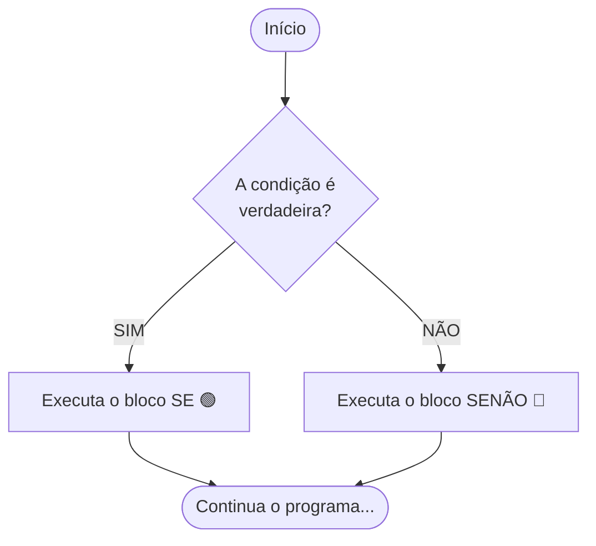
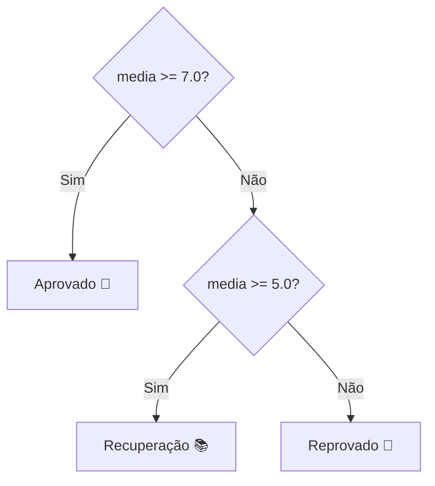

# 🔀 Capítulo 04: Estruturas Condicionais (se / senao)

| ⬅️ [Anterior: Operadores](03-operadores-aritmeticos-relacionais-e-logicos.md) | 🏠 [Início](../README.md) | ⚡ [Guia Rápido](../guia-rapido-portugol.md) | ➡️ [Próximo: Múltipla Escolha](05-multipla-escolha-escolha-caso.md) |
| :--- | :---: | :---: | ---: |

---

## 📋 Informações do Capítulo
- **Tempo estimado de estudo:** 60 minutos
- **Pré-requisitos:** [Capítulo 03](03-operadores-aritmeticos-relacionais-e-logicos.md).
- **Objetivos de Aprendizagem:**
  1. Compreender como programas tomam decisões e bifurcam seus caminhos.
  2. Aplicar a estrutura condicional simples (`se`).
  3. Construir decisões completas com `se / senao` e encadeadas com `senao se`.
  4. Evitar a armadilha clássica do ponto e vírgula indevido no `se`.

---

## 🚦 1. Analogia do Mundo Real: A Bifurcação na Estrada

Imagine que você está dirigindo e chega a uma bifurcação:
- **SE** o semáforo estiver **verde**, você segue em frente.
- **SENÃO**, você pisa no freio e para o carro.

Até agora, nossos programas eram como uma estrada reta de mão única: todas as linhas escritas eram executadas, sem exceção. Com as **estruturas condicionais**, seu programa ganha inteligência: ele analisa uma situação e **escolhe** qual bloco de código deve rodar e qual deve ser ignorado!



---

## 🚪 2. Condicional Simples: O Bloco `se`

Use o `se` simples quando você só precisa fazer algo se uma condição for satisfeita, e **nada** caso contrário:

```portugol
programa {
    funcao inicio() {
        inteiro idade

        escreva("Digite sua idade: ")
        leia(idade)

        se (idade >= 18) {
            escreva("Você é maior de idade!\n")
        }

        escreva("Fim do programa.\n")
    }
}
```

> [!NOTE]
> Se a pessoa digitar `15`, o código dentro de `{ }` do `se` é completamente ignorado e o programa pula direto para `escreva("Fim do programa.\n")`.

---

## ⚖️ 3. Condicional Composta: O Bloco `se / senao`

Quando você quer uma resposta para o caso verdadeiro E outra resposta para o caso falso:

```portugol
programa {
    funcao inicio() {
        real saldo = 100.0
        real saque

        escreva("Valor do saque: R$ ")
        leia(saque)

        se (saque <= saldo) {
            saldo = saldo - saque
            escreva("Saque realizado com sucesso! Novo saldo: R$ ", saldo, "\n")
        } senao {
            escreva("Saldo insuficiente! Operação cancelada.\n")
        }
    }
}
```

---

## 🪜 4. Condicional Encadeada: O `senao se`

E quando temos mais de dois caminhos possíveis? Por exemplo, num boletim com Aprovado, Recuperação e Reprovado:

```portugol
programa {
    funcao inicio() {
        real media

        escreva("Digite a média do aluno: ")
        leia(media)

        se (media >= 7.0) {
            escreva("Situação: APROVADO! Parabéns! 🎉\n")
        } senao se (media >= 5.0) {
            escreva("Situação: EM RECUPERAÇÃO. Estude mais! 📚\n")
        } senao {
            escreva("Situação: REPROVADO. Não desista! 💪\n")
        }
    }
}
```



---

## 🔍 5. Teste de Mesa Guiado

Simulação com entrada `media = 6.2`:

| Linha | Código | Avaliação Lógica | Ação |
| :---: | :--- | :--- | :--- |
| **8** | `se (media >= 7.0)` | `6.2 >= 7.0` é **falso** | Pula o bloco do primeiro `se` |
| **10** | `senao se (media >= 5.0)` | `6.2 >= 5.0` é **verdadeiro** | **Entra neste bloco!** |
| **11** | `escreva("... RECUPERAÇÃO ...")` | - | Imprime no console |
| **12** | `senao { ... }` | - | **Ignora completamente** o `senao` final |

---

## ⚠️ 6. A Armadilha Fatal do Ponto e Vírgula

> [!CAUTION]
> **NUNCA** coloque ponto e vírgula logo após a condição do `se`!
>
> ❌ **ERRADO:**
> ```portugol
> se (idade >= 18); // Esse ';' encerra a condição imediatamente!
> {
>     escreva("Você é maior!") // Vai rodar SEMPRE, mesmo com idade 10!
> }
> ```
> ✅ **CORRETO:**
> ```portugol
> se (idade >= 18) {
>     escreva("Você é maior!")
> }
> ```

---

## 🏋️ 7. Laboratório de Atividades Práticas

---

### 🟢 Atividade 1 (Fixação): Radar Eletrônico de Trânsito
Crie um programa que leia a velocidade de um carro em km/h.
- Se a velocidade for **maior que 80 km/h**, exiba uma mensagem de alerta dizendo que o motorista foi multado e o valor da multa (cada km acima do limite custa R$ 7.00).
- Se a velocidade estiver dentro do limite, exiba `"Boa viagem! Dirija com segurança."`.

<details>
<summary>💡 Dica</summary>

Valor da multa = `(velocidade - 80) * 7.0`.
</details>

<details>
<summary>✅ Ver Solução Comentada</summary>

```portugol
programa {
    funcao inicio() {
        real velocidade, excesso, multa

        escreva("Digite a velocidade do carro (km/h): ")
        leia(velocidade)

        se (velocidade > 80.0) {
            excesso = velocidade - 80.0
            multa = excesso * 7.0
            escreva("MULTADO! Você ultrapassou o limite de 80 km/h.\n")
            escreva("Excesso: ", excesso, " km/h | Valor da Multa: R$ ", multa, "\n")
        } senao {
            escreva("Velocidade dentro do permitido. Boa viagem!\n")
        }
    }
}
```
</details>

---

### 🟢 Atividade 2 (Fixação): O Maior de Dois Números
Leia dois números inteiros diferentes e mostre qual deles é o maior. Se forem iguais, avise ao usuário que os números são idênticos.

<details>
<summary>💡 Dica</summary>

Use `se (num1 > num2)`, `senao se (num2 > num1)` e `senao`.
</details>

<details>
<summary>✅ Ver Solução Comentada</summary>

```portugol
programa {
    funcao inicio() {
        inteiro num1, num2

        escreva("Digite o primeiro número: ")
        leia(num1)

        escreva("Digite o segundo número: ")
        leia(num2)

        se (num1 > num2) {
            escreva("O maior número é: ", num1, "\n")
        } senao se (num2 > num1) {
            escreva("O maior número é: ", num2, "\n")
        } senao {
            escreva("Os dois números são iguais!\n")
        }
    }
}
```
</details>

---

### 🟡 Atividade 3 (Prática Contextualizada): Alistamento Militar Obrigatório
No Brasil, jovens do sexo masculino que completam 18 anos no ano corrente devem se alistar.
Crie um programa que leia o **ano de nascimento** e o **gênero** (`'M'` ou `'F'`) da pessoa. Calcule a idade baseada no ano atual (2026).
- Se for mulher (`'F'`), avise: `"O alistamento militar não é obrigatório para mulheres."`
- Se for homem (`'M'`):
  - Com exatamente 18 anos: `"Está na hora exata de se alistar!"`
  - Com menos de 18 anos: `"Ainda faltam X anos para o alistamento."`
  - Com mais de 18 anos: `"Você já deveria ter se alistado há X anos!"`

<details>
<summary>💡 Dica</summary>

Você pode aninhar um `se` dentro do bloco do sexo masculino.
</details>

<details>
<summary>✅ Ver Solução Comentada</summary>

```portugol
programa {
    funcao inicio() {
        inteiro anoNascimento, idade, anosDiferenca
        caracter genero
        const inteiro ANO_ATUAL = 2026

        escreva("Digite seu ano de nascimento: ")
        leia(anoNascimento)

        escreva("Digite o gênero (M para masculino, F para feminino): ")
        leia(genero)

        idade = ANO_ATUAL - anoNascimento

        se (genero == 'F' ou genero == 'f') {
            escreva("O alistamento militar não é obrigatório para mulheres.\n")
        } senao {
            escreva("Você tem ", idade, " anos em ", ANO_ATUAL, ".\n")

            se (idade == 18) {
                escreva("Atenção: Você deve se alistar este ano!\n")
            } senao se (idade < 18) {
                anosDiferenca = 18 - idade
                escreva("Você ainda é menor. Faltam ", anosDiferenca, " ano(s) para seu alistamento.\n")
            } senao {
                anosDiferenca = idade - 18
                escreva("Você já passou da idade de alistamento há ", anosDiferenca, " ano(s)!\n")
            }
        }
    }
}
```
</details>

---

### 🟡 Atividade 4 (Prática Contextualizada): Calculadora de IMC Oficial
O Índice de Massa Corporal (IMC) é calculado por: $\text{IMC} = \frac{\text{peso}}{\text{altura}^2}$.
Faça um programa que leia o peso (kg) e a altura (m) de um usuário, calcule o IMC e informe a classificação segundo a OMS:
- Abaixo de 18.5: **Abaixo do peso**
- Entre 18.5 e 24.9: **Peso normal**
- Entre 25.0 e 29.9: **Sobrepeso**
- 30.0 ou mais: **Obesidade**

<details>
<summary>💡 Dica</summary>

Para calcular altura ao quadrado, use `altura * altura`.
</details>

<details>
<summary>✅ Ver Solução Comentada</summary>

```portugol
programa {
    funcao inicio() {
        real peso, altura, imc

        escreva("Digite seu peso em kg (ex: 70.5): ")
        leia(peso)

        escreva("Digite sua altura em metros (ex: 1.75): ")
        leia(altura)

        imc = peso / (altura * altura)

        escreva("\nSeu IMC calculado é: ", imc, "\n")
        escreva("Classificação: ")

        se (imc < 18.5) {
            escreva("Abaixo do peso normal.\n")
        } senao se (imc <= 24.9) {
            escreva("Peso ideal / normal. Parabéns!\n")
        } senao se (imc <= 29.9) {
            escreva("Sobrepeso (atenção aos hábitos).\n")
        } senao {
            escreva("Obesidade. Consulte um especialista.\n")
        }
    }
}
```
</details>

---

### 🐛 Atividade 5 (Caça-Bugs): O Erro de Atribuição no `se`
Descubra por que este programa acusa erro ou dá comportamento imprevisível:

```portugol
// CÓDIGO COM ERRO:
programa {
    funcao inicio() {
        inteiro senhaCorreta = 1234
        inteiro senhaDigitada

        escreva("Digite a senha: ")
        leia(senhaDigitada)

        // Encontre o erro grave nesta linha:
        se (senhaDigitada = 1234) {
            escreva("Acesso Liberado!\n")
        }
    }
}
```

<details>
<summary>💡 Dica</summary>

Compare `=` com `==`.
</details>

<details>
<summary>✅ Ver Solução Comentada</summary>

```portugol
// CÓDIGO CORRIGIDO:
programa {
    funcao inicio() {
        inteiro senhaDigitada

        escreva("Digite a senha: ")
        leia(senhaDigitada)

        se (senhaDigitada == 1234) {
            escreva("Acesso Liberado!\n")
        } senao {
            escreva("Senha Incorreta! Acesso Negado.\n")
        }
    }
}
```
**Explicação:** A condição usava `=` (atribuição), que tenta forçar o valor `1234` na variável, em vez de `==` (comparação de igualdade).
</details>

---

### 🔴 Atividade 6 (Desafio): Classificador Geométrico de Triângulos
Um triângulo só existe se cada um dos três lados for **menor que a soma dos outros dois**.
Crie um programa que leia 3 segmentos de reta (`a`, `b`, `c`).
1. Primeiro, verifique se eles **formam um triângulo**:
   `(a < b + c) e (b < a + c) e (c < a + b)`.
2. Se formarem, classifique o triângulo em:
   - **Equilátero:** se todos os 3 lados forem iguais (`a == b e b == c`).
   - **Isósceles:** se tiver 2 lados iguais.
   - **Escaleno:** se todos os lados forem diferentes (`a != b e b != c e a != c`).
3. Se não formarem triângulo, avise: `"Os segmentos não formam um triângulo."`

<details>
<summary>💡 Dica</summary>

Faça a verificação da existência primeiro. Se for verdadeiro, abra o bloco de classificação com `se / senao se / senao`.
</details>

<details>
<summary>✅ Ver Solução Comentada</summary>

```portugol
programa {
    funcao inicio() {
        real a, b, c
        logico formaTriangulo

        escreva("=== CLASSIFICADOR DE TRIÂNGULOS ===\n")
        escreva("Lado A: ")
        leia(a)
        escreva("Lado B: ")
        leia(b)
        escreva("Lado C: ")
        leia(c)

        formaTriangulo = (a < b + c) e (b < a + c) e (c < a + b)

        se (formaTriangulo == verdadeiro) {
            escreva("\nOs lados formam um triângulo válido!\nTipo: ")

            se (a == b e b == c) {
                escreva("EQUILÁTERO (todos os lados iguais).\n")
            } senao se (a != b e b != c e a != c) {
                escreva("ESCALENO (todos os lados diferentes).\n")
            } senao {
                escreva("ISÓSCELES (dois lados iguais).\n")
            }
        } senao {
            escreva("\nERRO: Esses lados NÃO conseguem fechar um triângulo!\n")
        }
    }
}
```
</details>

---

## 🎯 Autoavaliação do Capítulo 04

- [ ] Consigo usar `se`, `se / senao` e `senao se` com naturalidade.
- [ ] Sei que nunca devo colocar ponto e vírgula logo após o parêntese do `se`.
- [ ] Sei aninhar condicionais para checar regras compostas.

---

| ⬅️ [Anterior: Operadores](03-operadores-aritmeticos-relacionais-e-logicos.md) | 🏠 [Início](../README.md) | ⚡ [Guia Rápido](../guia-rapido-portugol.md) | ➡️ [Próximo: Múltipla Escolha](05-multipla-escolha-escolha-caso.md) |
| :--- | :---: | :---: | ---: |
