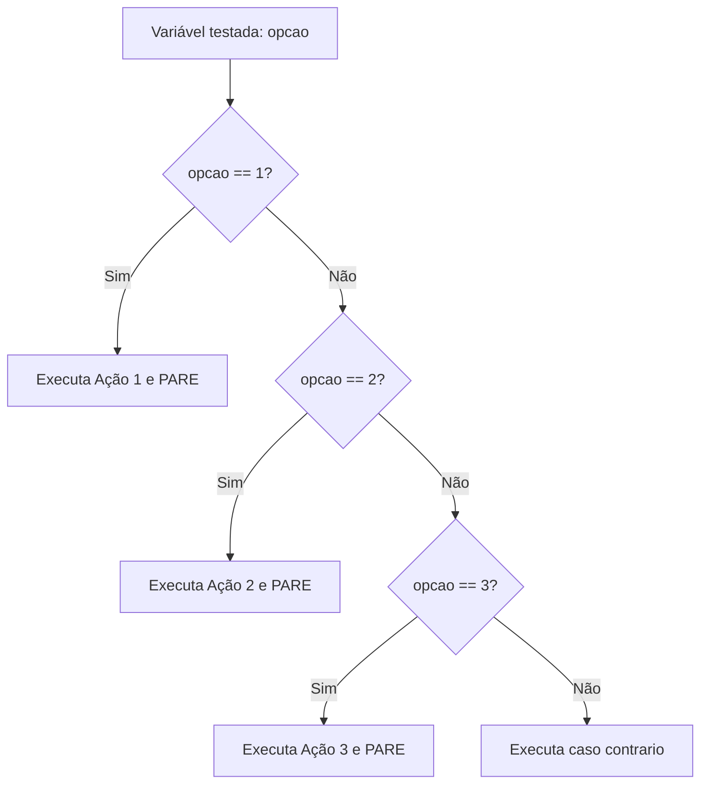

# 🎛️ Capítulo 05: Estrutura de Múltipla Escolha (escolha / caso)

| ⬅️ [Anterior: Condicionais se/senao](04-estruturas-condicionais-se-senao.md) | 🏠 [Início](../README.md) | ⚡ [Guia Rápido](../guia-rapido-portugol.md) | ➡️ [Próximo: Laços enquanto/faca](06-lacos-de-repeticao-enquanto-faca.md) |
| :--- | :---: | :---: | ---: |

---

## 📋 Informações do Capítulo
- **Tempo estimado de estudo:** 50 minutos
- **Pré-requisitos:** [Capítulo 04](04-estruturas-condicionais-se-senao.md).
- **Objetivos de Aprendizagem:**
  1. Identificar quando usar `escolha / caso` em vez de múltiplos `se / senao se`.
  2. Dominar as cláusulas `caso`, `pare` e `caso contrario`.
  3. Compreender o perigo e o funcionamento do efeito cascata (*fall-through*).
  4. Construir menus interativos elegantes e profissionais para o usuário.

---

## 🕹️ 1. Analogia do Mundo Real: O Controle Remoto da TV

Imagine que você está usando o controle da sua TV:
- Ao apertar o botão **1**, a TV sintoniza a Globo.
- Ao apertar o botão **2**, sintoniza o SBT.
- Ao apertar o botão **3**, sintoniza a Record.
- Ao apertar qualquer outro número não cadastrado, exibe: *"Canal não encontrado"*.

Se fôssemos programar isso com `se / senao`, teríamos um código enorme e poluído:
```portugol
se (canal == 1) { ... }
senao se (canal == 2) { ... }
senao se (canal == 3) { ... }
...
```

Para situações com **valores exatos e pré-definidos**, existe uma estrutura muito mais limpa: o **`escolha / caso`**!



---

## 🧱 2. A Sintaxe do `escolha / caso`

```portugol
programa {
    funcao inicio() {
        inteiro opcao

        escreva("=== MENU PRINCIPAL ===\n")
        escreva("1 - Salvar Arquivo\n")
        escreva("2 - Abrir Arquivo\n")
        escreva("3 - Sair do Programa\n")
        escreva("Escolha uma opção: ")
        leia(opcao)

        escolha (opcao) {
            caso 1:
                escreva("Arquivo salvo com sucesso!\n")
                pare // Sai imediatamente da estrutura escolha
            caso 2:
                escreva("Abrindo arquivo...\n")
                pare
            caso 3:
                escreva("Encerrando... Até logo!\n")
                pare
            caso contrario:
                escreva("ERRO: Opção inválida digitada!\n")
        }
    }
}
```

---

## 🛑 3. O Papel Crítico do Comando `pare`

> [!CAUTION]
> **O que acontece se você esquecer o comando `pare`?**
>
> O Portugol continuará executando **todos os casos que estão abaixo**, um após o outro, até encontrar um `pare` ou o fim do bloco! Isso é chamado de **efeito cascata** (*fall-through*).
> 
> A menos que você queira intencionalmente agrupar opções (por exemplo, os casos `'S'` e `'s'`), **nunca se esqueça de fechar cada `caso` com `pare`!**

---

## 🏷️ 4. O `caso contrario` (A Rede de Segurança)

O `caso contrario` funciona como o `senao` geral do menu. Se o usuário digitar qualquer valor que não tenha sido previsto nos casos anteriores (como `99` ou `-1`), o programa executará as instruções do `caso contrario:`.

---

## 🔍 5. Teste de Mesa Guiado

Simulação com entrada `opcao = 2`:

| Linha | Comando | Estado / Ação |
| :---: | :--- | :--- |
| **12** | `escolha (opcao)` | Avalia a variável `opcao` com valor `2` |
| **13** | `caso 1:` | Não corresponde (`2 != 1`), pula |
| **16** | `caso 2:` | **Corresponde! (`2 == 2`)** |
| **17** | `escreva("Abrindo...")` | Exibe no console |
| **18** | `pare` | **Interrompe o `escolha`** e salta para fora da chave `}` |
| **19+** | `caso 3:`, `caso contrario:` | **Ignorados com sucesso!** |

---

## ⚠️ 6. Regras e Limitações do `escolha / caso`

> [!IMPORTANT]
> - O `escolha` só aceita variáveis dos tipos **`inteiro`** ou **`caracter`**.
> - **Não é permitido** usar comparações ou intervalos no `caso`.
>   - ❌ `caso > 10:` (Erro de sintaxe!)
>   - ❌ `caso (x >= 5 e x <= 10):` (Não aceita expressões booleanas!)
>   - ✅ `caso 1:`, `caso 2:`, `caso 'A':`

Se você precisa testar intervalos (ex: "se nota entre 7 e 10"), utilize o `se / senao se` do Capítulo 04.

---

## 🏋️ 7. Laboratório de Atividades Práticas

---

### 🟢 Atividade 1 (Fixação): Dias da Semana
Crie um programa que leia um número inteiro de 1 a 7 e escreva por extenso o dia da semana correspondente (1 = Domingo, 2 = Segunda-feira, ..., 7 = Sábado). Se for digitado outro número, avise: `"Dia inválido!"`.

<details>
<summary>💡 Dica</summary>

Crie `caso 1:` até `caso 7:`, finalizando com `caso contrario:`.
</details>

<details>
<summary>✅ Ver Solução Comentada</summary>

```portugol
programa {
    funcao inicio() {
        inteiro dia

        escreva("Digite um número de 1 a 7: ")
        leia(dia)

        escolha (dia) {
            caso 1:
                escreva("Domingo (Final de Semana)\n")
                pare
            caso 2:
                escreva("Segunda-feira\n")
                pare
            caso 3:
                escreva("Terça-feira\n")
                pare
            caso 4:
                escreva("Quarta-feira\n")
                pare
            caso 5:
                escreva("Quinta-feira\n")
                pare
            caso 6:
                escreva("Sexta-feira\n")
                pare
            caso 7:
                escreva("Sábado (Final de Semana)\n")
                pare
            caso contrario:
                escreva("ERRO: Valor inválido! Digite apenas números de 1 a 7.\n")
        }
    }
}
```
</details>

---

### 🟢 Atividade 2 (Fixação): Calculadora de 4 Operações com Menu
Peça dois números reais (`num1` e `num2`) e apresente o seguinte menu:
`[1] Somar | [2] Subtrair | [3] Multiplicar | [4] Dividir`.
Execute a operação escolhida e mostre o resultado.
*(Atenção: Na divisão, verifique com um `se` se o divisor não é zero!).*

<details>
<summary>💡 Dica</summary>

Dentro do `caso 4:` da divisão, coloque um `se (num2 != 0)`.
</details>

<details>
<summary>✅ Ver Solução Comentada</summary>

```portugol
programa {
    funcao inicio() {
        real num1, num2, resultado
        inteiro operacao

        escreva("Primeiro número: ")
        leia(num1)

        escreva("Segundo número: ")
        leia(num2)

        escreva("\nEscolha a operação:\n")
        escreva("1 - Somar (+)\n")
        escreva("2 - Subtrair (-)\n")
        escreva("3 - Multiplicar (*)\n")
        escreva("4 - Dividir (/)\n")
        escreva("Opção: ")
        leia(operacao)

        escolha (operacao) {
            caso 1:
                resultado = num1 + num2
                escreva("Resultado da Soma: ", resultado, "\n")
                pare
            caso 2:
                resultado = num1 - num2
                escreva("Resultado da Subtração: ", resultado, "\n")
                pare
            caso 3:
                resultado = num1 * num2
                escreva("Resultado da Multiplicação: ", resultado, "\n")
                pare
            caso 4:
                se (num2 != 0.0) {
                    resultado = num1 / num2
                    escreva("Resultado da Divisão: ", resultado, "\n")
                } senao {
                    escreva("ERRO MATEMÁTICO: Não é possível dividir por zero!\n")
                }
                pare
            caso contrario:
                escreva("Operação inválida!\n")
        }
    }
}
```
</details>

---

### 🟡 Atividade 3 (Prática Contextualizada): Totem de Autoatendimento da Lanchonete
Crie o sistema de totem de pedidos de uma lanchonete:
- `101`: X-Burguer (R$ 15.00)
- `102`: X-Salada (R$ 18.00)
- `103`: Batata Frita (R$ 10.00)
- `104`: Refrigerante Lata (R$ 6.00)

O programa deve ler o código do item e a quantidade desejada. Deve calcular e exibir o nome do item e o valor total a pagar.

<details>
<summary>💡 Dica</summary>

No `caso 101:`, multiplique `quantidade * 15.0`.
</details>

<details>
<summary>✅ Ver Solução Comentada</summary>

```portugol
programa {
    funcao inicio() {
        inteiro codigo, quantidade
        real total = 0.0
        cadeia nomeItem = ""

        escreva("======================================\n")
        escreva("        LANCHONETE DO DEV             \n")
        escreva("======================================\n")
        escreva("[101] X-Burguer        - R$ 15.00\n")
        escreva("[102] X-Salada         - R$ 18.00\n")
        escreva("[103] Batata Frita     - R$ 10.00\n")
        escreva("[104] Refrigerante     - R$  6.00\n")
        escreva("======================================\n")

        escreva("Digite o código do produto: ")
        leia(codigo)

        escreva("Quantidade: ")
        leia(quantidade)

        escolha (codigo) {
            caso 101:
                nomeItem = "X-Burguer"
                total = quantidade * 15.00
                pare
            caso 102:
                nomeItem = "X-Salada"
                total = quantidade * 18.00
                pare
            caso 103:
                nomeItem = "Batata Frita"
                total = quantidade * 10.00
                pare
            caso 104:
                nomeItem = "Refrigerante"
                total = quantidade * 6.00
                pare
            caso contrario:
                escreva("Código de produto inexistente!\n")
        }

        se (total > 0.0) {
            escreva("\nPedido: ", quantidade, "x ", nomeItem, "\n")
            escreva("Total a Pagar: R$ ", total, "\n")
        }
    }
}
```
</details>

---

### 🟡 Atividade 4 (Prática Contextualizada): Casa de Câmbio
Crie um conversor de moedas. O usuário informa um valor em Reais (R$) e escolhe para qual moeda deseja converter:
- `1` - Dólar Americano (cotação: R$ 5.20)
- `2` - Euro (cotação: R$ 5.60)
- `3` - Libra Esterlina (cotação: R$ 6.50)
- `4` - Iene Japonês (cotação: R$ 0.035)

Exiba o valor convertido com o símbolo da moeda correspondente.

<details>
<summary>💡 Dica</summary>

O valor na moeda estrangeira é `valorReais / cotacao`.
</details>

<details>
<summary>✅ Ver Solução Comentada</summary>

```portugol
programa {
    funcao inicio() {
        real valorReais, valorConvertido
        inteiro opcaoMoeda

        escreva("Digite a quantia em Reais (R$): ")
        leia(valorReais)

        escreva("\nSelecione a moeda de destino:\n")
        escreva("1 - Dólar (USD)\n")
        escreva("2 - Euro (EUR)\n")
        escreva("3 - Libra (GBP)\n")
        escreva("4 - Iene (JPY)\n")
        escreva("Opção: ")
        leia(opcaoMoeda)

        escolha (opcaoMoeda) {
            caso 1:
                valorConvertido = valorReais / 5.20
                escreva("Valor convertido: $ ", valorConvertido, " USD\n")
                pare
            caso 2:
                valorConvertido = valorReais / 5.60
                escreva("Valor convertido: € ", valorConvertido, " EUR\n")
                pare
            caso 3:
                valorConvertido = valorReais / 6.50
                escreva("Valor convertido: £ ", valorConvertido, " GBP\n")
                pare
            caso 4:
                valorConvertido = valorReais / 0.035
                escreva("Valor convertido: ¥ ", valorConvertido, " JPY\n")
                pare
            caso contrario:
                escreva("Moeda inválida!\n")
        }
    }
}
```
</details>

---

### 🐛 Atividade 5 (Caça-Bugs): O Efeito Cascata Acidental
Um programador novato escreveu o menu abaixo para aplicar descontos, mas clientes que escolhem a Opção 1 estão recebendo mensagens de todas as outras opções! Encontre o erro e conserte:

```portugol
// CÓDIGO COM ERRO:
programa {
    funcao inicio() {
        inteiro plano = 1

        escolha (plano) {
            caso 1:
                escreva("Plano Bronze: 5% de desconto!\n")
            caso 2:
                escreva("Plano Prata: 10% de desconto!\n")
            caso 3:
                escreva("Plano Ouro: 20% de desconto!\n")
            caso contrario:
                escreva("Sem desconto.\n")
        }
    }
}
```

<details>
<summary>💡 Dica</summary>

O que impede o Portugol de "escorregar" para o caso seguinte?
</details>

<details>
<summary>✅ Ver Solução Comentada</summary>

```portugol
// CÓDIGO CORRIGIDO:
programa {
    funcao inicio() {
        inteiro plano = 1

        escolha (plano) {
            caso 1:
                escreva("Plano Bronze: 5% de desconto!\n")
                pare // Adicionado pare
            caso 2:
                escreva("Plano Prata: 10% de desconto!\n")
                pare // Adicionado pare
            caso 3:
                escreva("Plano Ouro: 20% de desconto!\n")
                pare // Adicionado pare
            caso contrario:
                escreva("Sem desconto.\n")
        }
    }
}
```
**Explicação:** Sem o comando `pare`, o Portugol executa a linha do `caso 1`, não para e continua executando os casos 2, 3 e até o `caso contrario`!
</details>

---

### 🔴 Atividade 6 (Desafio): Simulador de Estacionamento Inteligente
Crie um tarifador de estacionamento. O programa deve:
1. Ler o tipo de veículo:
   - `'C'` ou `'c'`: Carro (R$ 8.00 por hora)
   - `'M'` ou `'m'`: Moto (R$ 4.00 por hora)
   - `'V'` ou `'v'`: Van/Caminhonete (R$ 12.00 por hora)
2. Ler a quantidade de horas estacionado (`inteiro`).
3. Usar a estrutura `escolha / caso` avaliando a variável do tipo `caracter`.
*(Dica: você pode colocar dois casos juntos para pegar maiúsculo e minúsculo, por exemplo: `caso 'C': caso 'c': ... pare`!)*
4. Calcular e exibir o valor total cobrado.

<details>
<summary>💡 Dica</summary>

Quando dois casos realizam a mesma coisa, você pode empilhá-los sem `pare` entre eles:
```portugol
caso 'C':
caso 'c':
    // código
    pare
```
</details>

<details>
<summary>✅ Ver Solução Comentada</summary>

```portugol
programa {
    funcao inicio() {
        caracter tipoVeiculo
        inteiro horas
        real tarifaPorHora = 0.0, totalPagar

        escreva("=== ESTACIONAMENTO ROTATIVO ===\n")
        escreva("Tipos de veículo permitidos:\n")
        escreva("[C] Carro de Passeio\n")
        escreva("[M] Motocicleta\n")
        escreva("[V] Van / Caminhonete\n")
        escreva("Informe a letra correspondente: ")
        leia(tipoVeiculo)

        escreva("Quantas horas permaneceu estacionado? ")
        leia(horas)

        escolha (tipoVeiculo) {
            caso 'C':
            caso 'c':
                tarifaPorHora = 8.00
                pare
            caso 'M':
            caso 'm':
                tarifaPorHora = 4.00
                pare
            caso 'V':
            caso 'v':
                tarifaPorHora = 12.00
                pare
            caso contrario:
                escreva("Tipo de veículo não identificado!\n")
        }

        se (tarifaPorHora > 0.0) {
            totalPagar = tarifaPorHora * horas
            escreva("\n--- RECIBO DE PAGAMENTO ---\n")
            escreva("Permanência: ", horas, " hora(s)\n")
            escreva("Tarifa aplicada: R$ ", tarifaPorHora, "/h\n")
            escreva("Valor Total: R$ ", totalPagar, "\n")
        }
    }
}
```
</details>

---

## 🎯 Autoavaliação do Capítulo 05

- [ ] Sei estruturar um menu com `escolha`, `caso`, `pare` e `caso contrario`.
- [ ] Entendo por que o `pare` é indispensável após cada `caso`.
- [ ] Sei que `escolha` não serve para testar condições booleanas ou faixas numéricas com `>=`, apenas valores exatos.

---

| ⬅️ [Anterior: Condicionais se/senao](04-estruturas-condicionais-se-senao.md) | 🏠 [Início](../README.md) | ⚡ [Guia Rápido](../guia-rapido-portugol.md) | ➡️ [Próximo: Laços enquanto/faca](06-lacos-de-repeticao-enquanto-faca.md) |
| :--- | :---: | :---: | ---: |

