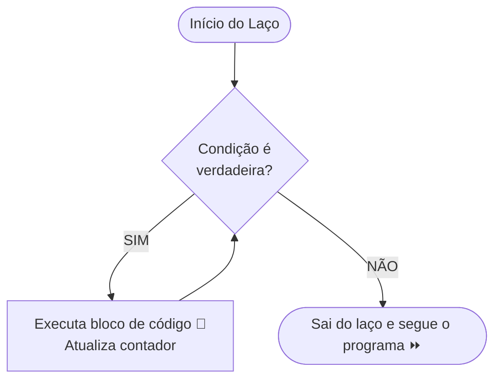

# 🔁 Capítulo 06: Laços de Repetição (enquanto / faca-enquanto)

| ⬅️ [Anterior: Múltipla Escolha](05-multipla-escolha-escolha-caso.md) | 🏠 [Início](../README.md) | ⚡ [Guia Rápido](../guia-rapido-portugol.md) | ➡️ [Próximo: Laço Contado (para)](07-laco-contado-para-e-teste-de-mesa.md) |
| :--- | :---: | :---: | ---: |

---

## 📋 Informações do Capítulo
- **Tempo estimado de estudo:** 65 minutos
- **Pré-requisitos:** [Capítulo 04](04-estruturas-condicionais-se-senao.md).
- **Objetivos de Aprendizagem:**
  1. Compreender a necessidade das estruturas de repetição (loops).
  2. Implementar repetições condicionais com `enquanto`.
  3. Aplicar o laço pós-testado `faca ... enquanto` para validação de dados.
  4. Dominar os conceitos fundamentais de **Contador**, **Acumulador** e **Sentinela**.
  5. Identificar e exterminar Loops Infinitos.

---

## 🍽️ 1. Analogia do Mundo Real: Lavando a Louça

Pense na tarefa de lavar pratos na pia:
1. Você olha para a pia.
2. **ENQUANTO** houver pratos sujos na pia:
   - Você pega um prato.
   - Ensaboa e enxágua.
   - Coloca no escorredor.
   - Olha para a pia novamente.
3. Quando a pia estiver vazia, você para e vai descansar.

Perceba que você não sabe de antemão se há 3, 10 ou 20 pratos. O que dita o fim do trabalho é uma **condição de parada**!

Se você não tivesse laços de repetição na programação e quisesse imprimir os números de 1 a 1.000, teria que digitar 1.000 linhas de `escreva()`. Com um laço de repetição, fazemos isso em **3 linhas**!



---

## 🔄 2. A Estrutura `enquanto` (Pré-testada)

O laço `enquanto` verifica a condição **antes** de executar qualquer coisa. Se a condição for falsa logo de início, o bloco não roda nem uma única vez!

```portugol
programa {
    funcao inicio() {
        inteiro contador = 1 // 1. Inicialização

        enquanto (contador <= 5) { // 2. Condição de teste
            escreva("Número: ", contador, "\n")
            contador = contador + 1 // 3. Passo / Incremento (CRUCIAL!)
        }

        escreva("Fim da contagem!\n")
    }
}
```

---

## 🧮 3. Os Dois Heróis dos Laços: Contador e Acumulador

### O Contador:
Serve para contar quantas vezes algo aconteceu. Ele avança em passos constantes (geralmente de 1 em 1):
```portugol
qtdAlunos = qtdAlunos + 1
// ou simplesmente:
qtdAlunos++
```

### O Acumulador:
Serve para somar valores variáveis (como um cofrinho onde cada moeda tem um valor diferente):
```portugol
totalCompras = totalCompras + precoDoItem
```

---

## 🚪 4. A Estrutura `faca ... enquanto` (Pós-testada)

Diferente do `enquanto`, o `faca ... enquanto` executa o bloco de código primeiro e só testa a condição **no final**. Isso garante que o código rode **pelo menos uma vez**!

É perfeito para validação de dados ("faça a pergunta... enquanto o usuário digitar errado, repita"):

```portugol
programa {
    funcao inicio() {
        real nota

        faca {
            escreva("Digite uma nota válida entre 0.0 e 10.0: ")
            leia(nota)

            se (nota < 0.0 ou nota > 10.0) {
                escreva("Nota inválida! Tente novamente.\n")
            }
        } enquanto (nota < 0.0 ou nota > 10.0)

        escreva("Nota registrada com sucesso: ", nota, "\n")
    }
}
```

---

## ♾️ 5. O Perigo do Loop Infinito

> [!CAUTION]
> Um **Loop Infinito** acontece quando a condição do laço nunca se torna falsa. O programa entra em transe, consome 100% da CPU e trava a aba do navegador!
>
> ❌ **EXEMPLO DE TRAVAMENTO:**
> ```portugol
> inteiro i = 1
> enquanto (i <= 10) {
>     escreva(i, "\n")
>     // ESQUECEU DE FAZER i = i + 1!
>     // A variável 'i' será 1 para sempre, e 1 <= 10 é sempre verdadeiro!
> }
> ```
> 
> Se isso acontecer com você no Portugol Webstudio: clique no botão vermelho **Parar** (`Shift + F5`) imediatamente!

---

## 🔍 6. Teste de Mesa Guiado: Rastreador de Acumulador

Considere o programa que soma números até o usuário digitar `0`:

```portugol
1: inteiro numero, soma = 0
2: escreva("Digite um número: ")
3: leia(numero)
4: enquanto (numero != 0) {
5:     soma = soma + numero
6:     escreva("Digite outro número (ou 0 para parar): ")
7:     leia(numero)
8: }
```

| Iteração | Valor Digitado (`numero`) | Condição `numero != 0` | Novo `soma` |
| :---: | :---: | :---: | :---: |
| Entrada Inicial | `10` | `10 != 0` (**verdadeiro**) | `0 + 10 = 10` |
| 1ª volta | `5` | `5 != 0` (**verdadeiro**) | `10 + 5 = 15` |
| 2ª volta | `20` | `20 != 0` (**verdadeiro**) | `15 + 20 = 35` |
| 3ª volta | `0` | `0 != 0` (**FALSO! Sai do laço**) | `35` (final) |

---

## 🏋️ 7. Laboratório de Atividades Práticas

---

### 🟢 Atividade 1 (Fixação): Lançamento de Foguete (Contagem Regressiva)
Faça um programa que faça uma contagem regressiva de **10 até 0** usando o laço `enquanto`. A cada número, imprima o valor. Ao final (quando passar de 0), exiba: `"🚀 LANÇAR! Foguete em órbita!"`.

<details>
<summary>💡 Dica</summary>

Inicie com `inteiro i = 10` e a cada volta faça `i = i - 1`.
</details>

<details>
<summary>✅ Ver Solução Comentada</summary>

```portugol
programa {
    funcao inicio() {
        inteiro tempo = 10

        escreva("Contagem regressiva iniciada...\n")

        enquanto (tempo >= 0) {
            escreva(tempo, "...\n")
            tempo = tempo - 1 // Decremento
        }

        escreva("🚀 LANÇAR! Foguete em órbita com sucesso!\n")
    }
}
```
</details>

---

### 🟢 Atividade 2 (Fixação): O Somador Infatigável (Sentinela)
Crie um programa que vá pedindo números inteiros ao usuário e somando-os. A repetição deve parar quando o usuário digitar o número **`0`** (o número `0` é a sentinela que indica parada). Ao sair, mostre o total da soma acumulada.

<details>
<summary>💡 Dica</summary>

Crie uma variável `soma = 0` e vá fazendo `soma = soma + valor`.
</details>

<details>
<summary>✅ Ver Solução Comentada</summary>

```portugol
programa {
    funcao inicio() {
        inteiro valor = 1
        inteiro soma = 0

        escreva("=== SOMADOR ACUMULATIVO ===\n")
        escreva("(Digite 0 a qualquer momento para encerrar)\n\n")

        enquanto (valor != 0) {
            escreva("Digite um número: ")
            leia(valor)
            soma = soma + valor
        }

        escreva("\nTotal acumulado de todos os números: ", soma, "\n")
    }
}
```
</details>

---

### 🟡 Atividade 3 (Prática Contextualizada): Validador de Senha com Bloqueio
Crie um sistema de autenticação. A senha correta é `2026`.
O usuário tem até **3 tentativas** para acertar a senha.
- Se acertar: exibe `"Acesso permitido! Bem-vindo ao sistema."` e interrompe as tentativas.
- Se errar as 3 vezes: exibe `"CONTA BLOQUEADA! Procure o administrador."`.

<details>
<summary>💡 Dica</summary>

Use um contador `tentativas = 1` e a condição `enquanto (tentativas <= 3 e senhaDigitada != 2026)`.
</details>

<details>
<summary>✅ Ver Solução Comentada</summary>

```portugol
programa {
    funcao inicio() {
        inteiro senhaDigitada = 0
        inteiro tentativas = 1
        logico acertou = falso
        const inteiro SENHA_MESTRA = 2026

        enquanto (tentativas <= 3 e acertou == falso) {
            escreva("Tentativa ", tentativas, " de 3. Digite a senha: ")
            leia(senhaDigitada)

            se (senhaDigitada == SENHA_MESTRA) {
                acertou = verdadeiro
            } senao {
                escreva("Senha incorreta!\n")
                tentativas = tentativas + 1
            }
        }

        se (acertou == verdadeiro) {
            escreva("\nAcesso autorizado com sucesso! 🔓\n")
        } senao {
            escreva("\nCONTA BLOQUEADA! Você errou as 3 tentativas. 🚫\n")
        }
    }
}
```
</details>

---

### 🟡 Atividade 4 (Prática Contextualizada): Caixa Registradora de Padaria
Crie um programa para somar as compras de um cliente na padaria.
O usuário vai digitando o preço de cada produto (`real`).
A condição de encerramento da compra é digitar o valor `0.0`.
Ao final, o programa deve informar:
1. O valor total da compra.
2. Quantos itens foram comprados (use um contador!).
3. Se o valor passar de R$ 50.00, informar que ele ganhou um cupom de sorteio.

<details>
<summary>💡 Dica</summary>

Use `contadorItens = contadorItens + 1` dentro do laço somente se o preço for maior que zero.
</details>

<details>
<summary>✅ Ver Solução Comentada</summary>

```portugol
programa {
    funcao inicio() {
        real preco = 1.0
        real total = 0.0
        inteiro qtdItens = 0

        escreva("=== PADARIA DO PORTUGOL ===\n")
        escreva("Digite o preço dos itens (ou 0 para fechar a conta):\n")

        enquanto (preco > 0.0) {
            escreva("Preço do item R$: ")
            leia(preco)

            se (preco > 0.0) {
                total = total + preco
                qtdItens = qtdItens + 1
            }
        }

        escreva("\n--- FECHAMENTO DA COMPRA ---\n")
        escreva("Itens comprados: ", qtdItens, "\n")
        escreva("Total a pagar: R$ ", total, "\n")

        se (total >= 50.0) {
            escreva("PARABÉNS! Você ganhou um cupom para o sorteio de fim de ano!\n")
        }
    }
}
```
</details>

---

### 🐛 Atividade 5 (Caça-Bugs): O Laço Congelado
Um aluno tentou imprimir os números pares de 2 a 20, mas o navegador dele travou com tela branca. Descubra o bug grave neste código:

```portugol
// CÓDIGO COM ERRO:
programa {
    funcao inicio() {
        inteiro num = 2

        enquanto (num <= 20) {
            escreva(num, " ")
            // O aluno esqueceu da linha que faz 'num' andar!
        }
        escreva("\nPronto!")
    }
}
```

<details>
<summary>💡 Dica</summary>

Como fazer a variável `num` pular de 2 em 2 até chegar em 20?
</details>

<details>
<summary>✅ Ver Solução Comentada</summary>

```portugol
// CÓDIGO CORRIGIDO:
programa {
    funcao inicio() {
        inteiro num = 2

        enquanto (num <= 20) {
            escreva(num, " ")
            num = num + 2 // Incrementa de 2 em 2
        }

        escreva("\nPronto!\n")
    }
}
```
**Explicação:** Faltava a instrução `num = num + 2`. Sem ela, `num` continuava valendo 2 eternamente, gerando um loop infinito.
</details>

---

### 🔴 Atividade 6 (Desafio): Jogo da Adivinhação de Número
Crie um jogo no qual o computador tem um número secreto fixo (por exemplo, `42`).
O jogador deve tentar adivinhar:
- A cada tentativa errada, o programa dá uma dica: `"O número secreto é MAIOR!"` ou `"O número secreto é MENOR!"`.
- O jogo continua até que o jogador acerte o número.
- Quando acertar, informe quantas tentativas foram necessárias para vencer!

<details>
<summary>💡 Dica</summary>

Use um laço `faca ... enquanto (palpite != numeroSecreto)`.
</details>

<details>
<summary>✅ Ver Solução Comentada</summary>

```portugol
programa {
    funcao inicio() {
        const inteiro NUMERO_SECRETO = 42
        inteiro palpite
        inteiro tentativas = 0

        escreva("=========================================\n")
        escreva("       JOGO DA ADIVINHAÇÃO MENTAL        \n")
        escreva("  Tente adivinhar o número entre 1 e 100 \n")
        escreva("=========================================\n\n")

        faca {
            escreva("Qual é o seu palpite? ")
            leia(palpite)
            tentativas = tentativas + 1

            se (palpite < NUMERO_SECRETO) {
                escreva(">> Dica: O número secreto é MAIOR que ", palpite, "!\n\n")
            } senao se (palpite > NUMERO_SECRETO) {
                escreva(">> Dica: O número secreto é MENOR que ", palpite, "!\n\n")
            }
        } enquanto (palpite != NUMERO_SECRETO)

        escreva("🎉 PARABÉNS! Você acertou o número secreto ", NUMERO_SECRETO, "!\n")
        escreva("Total de palpites utilizados: ", tentativas, "\n")
    }
}
```
</details>

---

## 🎯 Autoavaliação do Capítulo 06

- [ ] Entendo a diferença entre `enquanto` (testa antes) e `faca ... enquanto` (testa depois).
- [ ] Sei criar e atualizar Contadores e Acumuladores dentro de loops.
- [ ] Sei como evitar loops infinitos garantindo que a condição mude para falsa.

---

| ⬅️ [Anterior: Múltipla Escolha](05-multipla-escolha-escolha-caso.md) | 🏠 [Início](../README.md) | ⚡ [Guia Rápido](../guia-rapido-portugol.md) | ➡️ [Próximo: Laço Contado (para)](07-laco-contado-para-e-teste-de-mesa.md) |
| :--- | :---: | :---: | ---: |
