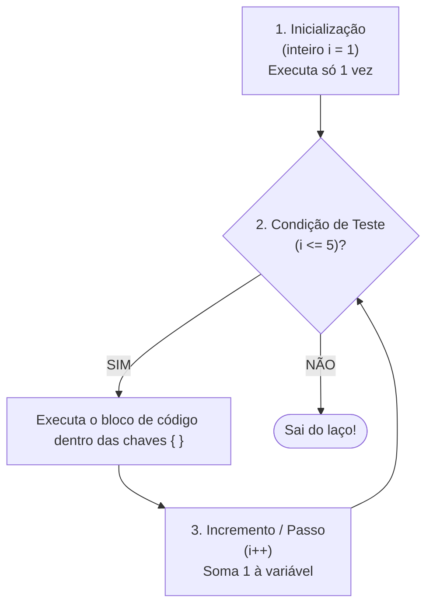

# 🔢 Capítulo 07: Laço Contado (para) & O Método do Teste de Mesa

| ⬅️ [Anterior: Laços enquanto/faca](06-lacos-de-repeticao-enquanto-faca.md) | 🏠 [Início](../README.md) | ⚡ [Guia Rápido](../guia-rapido-portugol.md) | ➡️ [Próximo: Vetores](08-vetores-listas-unidimensionais.md) |
| :--- | :---: | :---: | ---: |

---

## 📋 Informações do Capítulo
- **Tempo estimado de estudo:** 65 minutos
- **Pré-requisitos:** [Capítulo 06](06-lacos-de-repeticao-enquanto-faca.md).
- **Objetivos de Aprendizagem:**
  1. Dominar a estrutura do laço contado `para`.
  2. Saber escolher com precisão entre `para` e `enquanto`.
  3. Dominar o **Teste de Mesa Profissional** para rastrear qualquer algoritmo no papel.
  4. Trabalhar com laços aninhados (laço dentro de laço).

---

## 🏃 1. Analogia do Mundo Real: As 10 Flexões

Imagine seu professor de educação física mandando:
> *"Faça exatamente 10 flexões!"*

Você não precisa adivinhar quando vai parar:
1. Você começa na flexão número 1 (**Inicialização**).
2. Antes de fazer a próxima, você checa se ainda não passou de 10 (**Condição**).
3. Cada vez que termina uma flexão, você conta: 1, 2, 3... (**Incremento**).
4. Ao chegar no 10, você completou a meta!

Quando **já sabemos de antemão** quantas repetições precisamos fazer, o laço **`para`** é a estrutura mais limpa, elegante e segura da programação.

---

## 🔬 2. Anatomia do Laço `para`

O cabeçalho do `para` reúne em uma única linha as três engrenagens que antes ficavam espalhadas:

```portugol
//     ( 1. Início   ;  2. Teste  ; 3. Passo )
para (inteiro i = 1 ;    i <= 5   ;   i++     ) {
    escreva("Volta número: ", i, "\n")
}
```



> [!IMPORTANT]
> As três partes dentro dos parênteses do `para` são separadas por **ponto e vírgula `;`** e nunca por vírgulas!

---

## ⚖️ 3. Quando Usar `para` vs `enquanto`?

| Característica | Use `para` | Use `enquanto` |
| :--- | :---: | :---: |
| Sabe o número exato de voltas antes de começar? | ✅ **SIM** (ex: 10 vezes, tamanho da lista) | ❌ Não necessariamente |
| A parada depende de algo digitado pelo usuário? | ❌ Raramente | ✅ **SIM** (ex: "enquanto não digitar 0") |
| Risco de esquecer o incremento e travar o loop? | 🟢 **Mínimo** (o passo fica no cabeçalho) | 🔴 Médio (se esquecer `i++`) |

---

## 📝 4. O Método Definitivo do Teste de Mesa

O Teste de Mesa é a habilidade que separa programadores amadores de profissionais. Trata-se de criar uma tabela no papel ou bloco de notas para acompanhar o valor de cada variável a cada ciclo do loop.

Observe o código:
```portugol
1: inteiro soma = 0
2: para (inteiro i = 1; i <= 3; i++) {
3:     soma = soma + i
4: }
```

### Tabela de Rastreamento (Teste de Mesa):

| Linha | Variável `i` | Teste `i <= 3` | Cálculo `soma + i` | Novo `soma` |
| :---: | :---: | :---: | :---: | :---: |
| **1** | - | - | - | `0` |
| **2** | `1` | `1 <= 3` (V) | `0 + 1` | `1` |
| **3** | `2` | `2 <= 3` (V) | `1 + 2` | `3` |
| **3** | `3` | `3 <= 3` (V) | `3 + 3` | `6` |
| **2** | `4` | `4 <= 3` (**FALSO**) | - | `6` *(Fim! Sai do laço)* |

Ao final, `soma` vale **`6`** e `i` terminou valendo **`4`**.

---

## 🔄 5. Laços Aninhados (Laço dentro de Laço)

Podemos colocar um laço `para` dentro de outro. Para cada volta do laço de fora, o laço de dentro roda todas as suas repetições:

```portugol
para (inteiro linha = 1; linha <= 3; linha++) {
    para (inteiro coluna = 1; coluna <= 3; coluna++) {
        escreva("[", linha, ",", coluna, "] ")
    }
    escreva("\n") // Pula de linha ao final de cada linha
}
```
**Resultado:**
```text
[1,1] [1,2] [1,3] 
[2,1] [2,2] [2,3] 
[3,1] [3,2] [3,3] 
```

---

## ⚠️ 6. Erros Comuns

1. **Confundir `<` com `<=` (O erro *Off-By-One*):**
   - Se quer contar até 10: `i <= 10`. Se colocar `i < 10`, ele para no 9!
2. **Separar com vírgula:**
   - ❌ `para (inteiro i = 0, i < 10, i++)`
   - ✅ `para (inteiro i = 0; i < 10; i++)`

---

## 🏋️ 7. Laboratório de Atividades Práticas

---

### 🟢 Atividade 1 (Fixação): O Gerador de Tabuada
Peça ao usuário um número inteiro (ex: `7`). Utilizando um laço `para`, exiba a tabuada completa de multiplicação desse número de **1 até 10**.

<details>
<summary>💡 Dica</summary>

Faça o `i` variar de `1` até `10` e calcule `numero * i`.
</details>

<details>
<summary>✅ Ver Solução Comentada</summary>

```portugol
programa {
    funcao inicio() {
        inteiro num

        escreva("Digite um número para ver a tabuada: ")
        leia(num)

        escreva("\n--- TABUADA DO ", num, " ---\n")
        para (inteiro i = 1; i <= 10; i++) {
            escreva(num, " x ", i, " = ", num * i, "\n")
        }
    }
}
```
</details>

---

### 🟢 Atividade 2 (Fixação): Somatório de 1 até N
Peça um número limite $N$ ao usuário (ex: $N = 100$). Calcule a soma de todos os números de $1$ até $N$ ($1 + 2 + 3 + \dots + N$). Mostre o resultado final.

<details>
<summary>💡 Dica</summary>

Use uma variável acumuladora `soma = 0` antes do laço e faça `soma = soma + i`.
</details>

<details>
<summary>✅ Ver Solução Comentada</summary>

```portugol
programa {
    funcao inicio() {
        inteiro n, soma = 0

        escreva("Calcular a soma de 1 até quanto? ")
        leia(n)

        para (inteiro i = 1; i <= n; i++) {
            soma = soma + i
        }

        escreva("A soma total de 1 até ", n, " é: ", soma, "\n")
    }
}
```
</details>

---

### 🟡 Atividade 3 (Prática Contextualizada): Cálculo do Fatorial ($N!$)
O fatorial de um número natural é a multiplicação dele por todos os seus antecessores até 1.
Exemplo: $5! = 5 \times 4 \times 3 \times 2 \times 1 = 120$.
Crie um programa que calcule o fatorial de um número digitado.

<details>
<summary>💡 Dica</summary>

Inicie a variável com `fatorial = 1` (se começar em zero, qualquer multiplicação resultará em zero!).
</details>

<details>
<summary>✅ Ver Solução Comentada</summary>

```portugol
programa {
    funcao inicio() {
        inteiro n
        inteiro fatorial = 1

        escreva("Digite um número para calcular o fatorial: ")
        leia(n)

        para (inteiro i = n; i >= 1; i--) {
            fatorial = fatorial * i
        }

        escreva("O fatorial de ", n, "! é: ", fatorial, "\n")
    }
}
```
</details>

---

### 🟡 Atividade 4 (Prática Contextualizada): O Maior e o Menor de uma Série
Peça ao usuário para digitar **5 números inteiros**. À medida que cada número for lido, descubra qual foi o **maior** e qual foi o **menor** número digitado até então. Ao final dos 5 números, exiba ambos.

<details>
<summary>💡 Dica</summary>

Na primeira repetição (`se (i == 1)`), tanto o `maior` quanto o `menor` devem receber o primeiro número lido!
</details>

<details>
<summary>✅ Ver Solução Comentada</summary>

```portugol
programa {
    funcao inicio() {
        inteiro valor, maior, menor

        para (inteiro i = 1; i <= 5; i++) {
            escreva("Digite o ", i, "º número: ")
            leia(valor)

            se (i == 1) {
                // Na primeira volta, inicializa ambos com o primeiro valor lido
                maior = valor
                menor = valor
            } senao {
                se (valor > maior) {
                    maior = valor
                }
                se (valor < menor) {
                    menor = valor
                }
            }
        }

        escreva("\n--- ANÁLISE DOS 5 NÚMEROS ---\n")
        escreva("Maior número digitado: ", maior, "\n")
        escreva("Menor número digitado: ", menor, "\n")
    }
}
```
</details>

---

### 🐛 Atividade 5 (Caça-Bugs): O Cabeçalho com Defeito
Descubra os 2 erros de sintaxe no laço `para` a seguir:

```portugol
// CÓDIGO COM ERRO:
programa {
    funcao inicio() {
        // Encontre os erros nos separadores e na declaração
        para (i = 0, i <= 10, i++) {
            escreva(i, " ")
        }
    }
}
```

<details>
<summary>💡 Dica</summary>

1. A variável `i` foi declarada com seu tipo?
2. O que separa as 3 partes do `para`?
</details>

<details>
<summary>✅ Ver Solução Comentada</summary>

```portugol
// CÓDIGO CORRIGIDO:
programa {
    funcao inicio() {
        para (inteiro i = 0; i <= 10; i++) {
            escreva(i, " ")
        }
        escreva("\n")
    }
}
```
**O que foi corrigido?**
- Faltava o tipo `inteiro` antes do `i`.
- As vírgulas foram substituídas por ponto e vírgula `;`.
</details>

---

### 🔴 Atividade 6 (Desafio): Desenhista de Pirâmide com Laços Aninhados
Peça ao usuário a quantidade de andares da pirâmide (ex: `5`). Utilizando dois laços `para` aninhados, desenhe um triângulo retângulo feito de asteriscos no console:

```text
*
**
***
****
*****
```

<details>
<summary>💡 Dica</summary>

O laço externo conta as linhas (`linha = 1` até `totalLinhas`).
O laço interno imprime os asteriscos (`coluna = 1` até `coluna <= linha`).
</details>

<details>
<summary>✅ Ver Solução Comentada</summary>

```portugol
programa {
    funcao inicio() {
        inteiro andares

        escreva("Quantos andares terá a pirâmide? ")
        leia(andares)

        escreva("\n")
        para (inteiro linha = 1; linha <= andares; linha++) {
            para (inteiro asterisco = 1; asterisco <= linha; asterisco++) {
                escreva("*")
            }
            escreva("\n") // Pula de linha ao terminar o andar
        }
    }
}
```
</details>

---

## 🎯 Autoavaliação do Capítulo 07

- [ ] Sei escrever um laço `para` com inicialização, condição e incremento.
- [ ] Sei fazer um Teste de Mesa desenhando a tabela de variáveis no papel.
- [ ] Entendo como laços aninhados funcionam para criar grades ou padrões.

---

| ⬅️ [Anterior: Laços enquanto/faca](06-lacos-de-repeticao-enquanto-faca.md) | 🏠 [Início](../README.md) | ⚡ [Guia Rápido](../guia-rapido-portugol.md) | ➡️ [Próximo: Vetores](08-vetores-listas-unidimensionais.md) |
| :--- | :---: | :---: | ---: |
