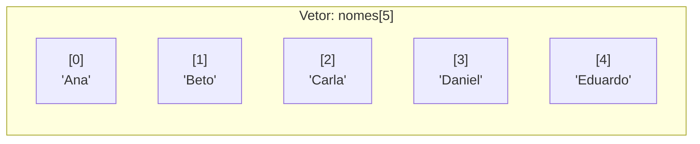

# 📋 Capítulo 08: Vetores (Listas Unidimensionais)

| ⬅️ [Anterior: Laço Contado (para)](07-laco-contado-para-e-teste-de-mesa.md) | 🏠 [Início](../README.md) | ⚡ [Guia Rápido](../guia-rapido-portugol.md) | ➡️ [Próximo: Matrizes](09-matrizes-tabelas-bidimensionais.md) |
| :--- | :---: | :---: | ---: |

---

## 📋 Informações do Capítulo
- **Tempo estimado de estudo:** 75 minutos
- **Pré-requisitos:** [Capítulo 07](07-laco-contado-para-e-teste-de-mesa.md).
- **Objetivos de Aprendizagem:**
  1. Compreender por que precisamos de estruturas de dados coletivas.
  2. Declarar e inicializar vetores no Portugol Webstudio.
  3. Dominar a regra do **Índice Base-Zero** (por que começamos do 0).
  4. Percorrer, preencher e consultar vetores usando o laço `para`.
  5. Implementar algoritmos de busca e análise de dados em listas.

---

## 🗄️ 1. Analogia do Mundo Real: O Gaveteiro de Peças

Imagine que você precisa guardar o nome de 50 alunos de uma sala.
Sem vetores, seu código seria um pesadelo:
```portugol
cadeia aluno1, aluno2, aluno3, ..., aluno50
```
Como você calcularia a média ou procuraria um aluno sem escrever 50 blocos `se` repetidos?

A solução é o **Vetor**: um armário ou gaveteiro com um único nome (`alunos`), dividido em gavetas idênticas, cada uma identificada por um número (**índice**):



---

## 0️⃣ 2. A Regra de Ouro: O Primeiro Índice é SEMPRE Zero!

> [!CAUTION]
> Essa é a pegadinha que mais confunde iniciantes em todo o planeta!
> Se um vetor tem **5 posições**, suas gavetas são numeradas de **`0` até `4`**:
> - 1ª posição: `vetor[0]`
> - 2ª posição: `vetor[1]`
> - 3ª posição: `vetor[2]`
> - 4ª posição: `vetor[3]`
> - 5ª posição: `vetor[4]`
> 
> Tentar acessar `vetor[5]` causará o erro fatal: **Índice fora dos limites permitidos!**

---

## 🛠️ 3. Como Declarar e Usar Vetores no Portugol

```portugol
// Declara um vetor de 4 números reais vazio
real notas[4]

// Guardando valores diretamente nas posições:
notas[0] = 8.5
notas[1] = 7.0
notas[2] = 9.2
notas[3] = 6.4

// Ou declarar já preenchido:
cadeia frutas[3] = {"Maçã", "Banana", "Morango"}
```

---

## 🤝 4. O Casamento Perfeito: Vetor + Laço `para`

Como as gavetas do vetor são numeradas de `0` até `Tamanho - 1`, usamos a variável `i` do laço `para` para visitar todas as gavetas automaticamente:

```portugol
programa {
    funcao inicio() {
        inteiro numeros[5]

        // 1. Preenchendo o vetor pelo teclado:
        para (inteiro i = 0; i < 5; i++) {
            escreva("Digite o ", i + 1, "º número (gaveta [", i, "]): ")
            leia(numeros[i])
        }

        // 2. Exibindo todos os números guardados:
        escreva("\nValores guardados no vetor: ")
        para (inteiro i = 0; i < 5; i++) {
            escreva("[", numeros[i], "] ")
        }
        escreva("\n")
    }
}
```

---

## 🔍 5. Teste de Mesa Guiado: Somando um Vetor

Vetor analisado: `valores = {10, 20, 30}`:

```portugol
inteiro soma = 0
para (inteiro i = 0; i < 3; i++) {
    soma = soma + valores[i]
}
```

| Volta (`i`) | `i < 3` | `valores[i]` acessado | Operação `soma + valores[i]` | Novo `soma` |
| :---: | :---: | :---: | :---: | :---: |
| `0` | `0 < 3` (V) | `valores[0] = 10` | `0 + 10` | `10` |
| `1` | `1 < 3` (V) | `valores[1] = 20` | `10 + 20` | `30` |
| `2` | `2 < 3` (V) | `valores[2] = 30` | `30 + 30` | `60` |
| `3` | `3 < 3` (**F**) | - *(Fim do laço)* | - | `60` |

---

## ⚠️ 6. Erros Comuns

1. **Esquecer os colchetes:** `escreva(notas)` imprime o endereço de memória, não os valores. Você deve especificar qual gaveta quer: `escreva(notas[i])`.
2. **Laço começando em 1 e terminando em tamanho:**
   - ❌ `para (inteiro i = 1; i <= 5; i++)` $\rightarrow$ perde a gaveta `[0]` e estoura o limite no `[5]`.
   - ✅ `para (inteiro i = 0; i < 5; i++)` $\rightarrow$ visita `0, 1, 2, 3, 4`.

---

## 🏋️ 7. Laboratório de Atividades Práticas

---

### 🟢 Atividade 1 (Fixação): Inversor de Vetor
Peça ao usuário para digitar **5 números inteiros** e armazene-os em um vetor. Em seguida, usando um segundo laço `para`, exiba os números na **ordem inversa** (do último digitado para o primeiro).

<details>
<summary>💡 Dica</summary>

O segundo laço deve começar em `i = 4` e ir até `i >= 0`, decrementando com `i--`.
</details>

<details>
<summary>✅ Ver Solução Comentada</summary>

```portugol
programa {
    funcao inicio() {
        inteiro numeros[5]

        escreva("=== LEITURA DE 5 NÚMEROS ===\n")
        para (inteiro i = 0; i < 5; i++) {
            escreva("Digite o valor para a posição ", i, ": ")
            leia(numeros[i])
        }

        escreva("\n--- EXIBINDO NA ORDEM INVERSA ---\n")
        para (inteiro i = 4; i >= 0; i--) {
            escreva(numeros[i], " ")
        }
        escreva("\n")
    }
}
```
</details>

---

### 🟢 Atividade 2 (Fixação): Estatísticas da Turma
Crie um programa que leia as notas de **5 alunos** em um vetor de reais. Calcule e exiba:
1. A média geral da turma.
2. A lista de notas que ficaram **iguais ou acima da média**.

<details>
<summary>💡 Dica</summary>

Primeiro faça um laço para somar todas as notas e calcular a média. Depois faça um segundo laço com um `se (notas[i] >= media)` para imprimir apenas as notas que se destacaram.
</details>

<details>
<summary>✅ Ver Solução Comentada</summary>

```portugol
programa {
    funcao inicio() {
        real notas[5]
        real soma = 0.0, media

        para (inteiro i = 0; i < 5; i++) {
            escreva("Nota do aluno ", i + 1, ": ")
            leia(notas[i])
            soma = soma + notas[i]
        }

        media = soma / 5.0

        escreva("\n--- RESULTADOS ---\n")
        escreva("Média da turma: ", media, "\n")
        escreva("Notas aprovadas (iguais ou acima da média):\n")

        para (inteiro i = 0; i < 5; i++) {
            se (notas[i] >= media) {
                escreva("-> Aluno ", i + 1, ": ", notas[i], "\n")
            }
        }
    }
}
```
</details>

---

### 🟡 Atividade 3 (Prática Contextualizada): A Lista VIP (Busca Linear)
Crie um vetor com **5 nomes de convidados VIP** já pré-definidos:
`cadeia convidados[5] = {"Ana", "Bruno", "Carlos", "Diana", "Eduardo"}`.
Peça ao segurança para digitar o nome da pessoa que quer entrar. O programa deve pesquisar no vetor:
- Se encontrar, exibe: `"Acesso Liberado! Nome na lista VIP (posição X)."`
- Se percorrer todo o vetor e não encontrar, avise: `"Nome não consta na lista VIP."`

<details>
<summary>💡 Dica</summary>

Use uma variável lógica `encontrado = falso`. Se achar o nome, mude para `verdadeiro`.
</details>

<details>
<summary>✅ Ver Solução Comentada</summary>

```portugol
programa {
    funcao inicio() {
        cadeia convidados[5] = {"Ana", "Bruno", "Carlos", "Diana", "Eduardo"}
        cadeia nomeBuscado
        logico encontrado = falso
        inteiro posicaoEncontrada = -1

        escreva("Digite o nome para verificação na portaria: ")
        leia(nomeBuscado)

        para (inteiro i = 0; i < 5; i++) {
            se (convidados[i] == nomeBuscado) {
                encontrado = verdadeiro
                posicaoEncontrada = i
                pare // Achou, não precisa olhar os outros
            }
        }

        se (encontrado == verdadeiro) {
            escreva("\n✅ Acesso LIBERADO! ", nomeBuscado, " está na lista VIP (gaveta ", posicaoEncontrada, ").\n")
        } senao {
            escreva("\n🚫 Acesso NEGADO! O nome ", nomeBuscado, " NÃO foi encontrado na lista.\n")
        }
    }
}
```
</details>

---

### 🟡 Atividade 4 (Prática Contextualizada): Separador de Pares e Ímpares
Leia **8 números inteiros** e guarde-os em um vetor `original[8]`.
Em seguida, conte quantos números pares e ímpares foram digitados e exiba-os separadamente na tela.

<details>
<summary>💡 Dica</summary>

Percorra o vetor `original`: se `original[i] % 2 == 0` imprima na seção de pares; se não, na seção de ímpares.
</details>

<details>
<summary>✅ Ver Solução Comentada</summary>

```portugol
programa {
    funcao inicio() {
        inteiro numeros[8]

        escreva("Digite 8 números inteiros:\n")
        para (inteiro i = 0; i < 8; i++) {
            escreva("Número [", i, "]: ")
            leia(numeros[i])
        }

        escreva("\n--- NÚMEROS PARES ---\n")
        para (inteiro i = 0; i < 8; i++) {
            se (numeros[i] % 2 == 0) {
                escreva(numeros[i], " ")
            }
        }

        escreva("\n\n--- NÚMEROS ÍMPARES ---\n")
        para (inteiro i = 0; i < 8; i++) {
            se (numeros[i] % 2 != 0) {
                escreva(numeros[i], " ")
            }
        }
        escreva("\n")
    }
}
```
</details>

---

### 🐛 Atividade 5 (Caça-Bugs): O Estouro de Limites (*Index Out of Bounds*)
Encontre o erro que faz o Portugol Webstudio travar na execução do código a seguir:

```portugol
// CÓDIGO COM ERRO:
programa {
    funcao inicio() {
        inteiro precos[4]

        // Encontre o erro no cabeçalho do 'para':
        para (inteiro i = 0; i <= 4; i++) {
            precos[i] = i * 10
            escreva(precos[i], " ")
        }
    }
}
```

<details>
<summary>💡 Dica</summary>

Um vetor de 4 posições possui gavetas de `0` até `3`. O que acontece quando `i` atinge o valor `4`?
</details>

<details>
<summary>✅ Ver Solução Comentada</summary>

```portugol
// CÓDIGO CORRIGIDO:
programa {
    funcao inicio() {
        inteiro precos[4]

        // Usar < 4 ou <= 3
        para (inteiro i = 0; i < 4; i++) {
            precos[i] = i * 10
            escreva(precos[i], " ")
        }
        escreva("\n")
    }
}
```
**Explicação:** Ao usar `i <= 4`, na última repetição o programa tentava acessar `precos[4]`, que não existe (já que as 4 gavetas são `0`, `1`, `2` e `3`).
</details>

---

### 🔴 Atividade 6 (Desafio): Intercalador de Dois Vetores
Crie dois vetores de 3 posições cada com valores pré-definidos:
- `v1 = {1, 3, 5}`
- `v2 = {2, 4, 6}`

Crie um terceiro vetor `intercalado[6]` que una os elementos alternadamente: primeiro um do `v1`, depois um do `v2`:
Resultado esperado: `{1, 2, 3, 4, 5, 6}`.

<details>
<summary>💡 Dica</summary>

Use um índice para `v1` e `v2` e outro índice para o vetor `intercalado`, ou note que:
`intercalado[i * 2] = v1[i]`
`intercalado[i * 2 + 1] = v2[i]`
</details>

<details>
<summary>✅ Ver Solução Comentada</summary>

```portugol
programa {
    funcao inicio() {
        inteiro v1[3] = {1, 3, 5}
        inteiro v2[3] = {2, 4, 6}
        inteiro intercalado[6]

        para (inteiro i = 0; i < 3; i++) {
            intercalado[i * 2] = v1[i]
            intercalado[i * 2 + 1] = v2[i]
        }

        escreva("Vetor Intercalado Resultante:\n")
        para (inteiro i = 0; i < 6; i++) {
            escreva("[", intercalado[i], "] ")
        }
        escreva("\n")
    }
}
```
</details>

---

## 🎯 Autoavaliação do Capítulo 08

- [ ] Entendo por que vetores sempre começam com índice 0.
- [ ] Sei que um vetor de tamanho $N$ vai de $0$ até $N-1$.
- [ ] Sei percorrer e preencher vetores usando `para (inteiro i = 0; i < N; i++)`.

---

| ⬅️ [Anterior: Laço Contado (para)](07-laco-contado-para-e-teste-de-mesa.md) | 🏠 [Início](../README.md) | ⚡ [Guia Rápido](../guia-rapido-portugol.md) | ➡️ [Próximo: Matrizes](09-matrizes-tabelas-bidimensionais.md) |
| :--- | :---: | :---: | ---: |

