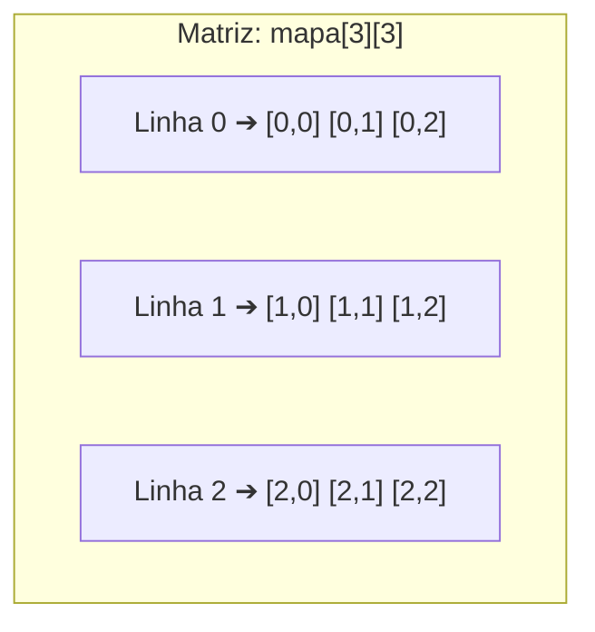
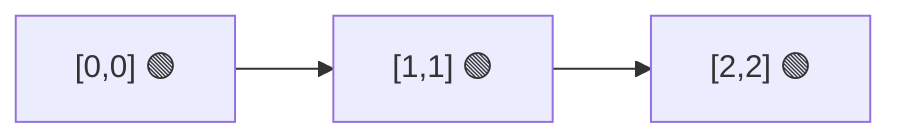

# 🗄️ Capítulo 09: Matrizes (Tabelas Bidimensionais)

| ⬅️ [Anterior: Vetores](08-vetores-listas-unidimensionais.md) | 🏠 [Início](../README.md) | ⚡ [Guia Rápido](../guia-rapido-portugol.md) | ➡️ [Próximo: Funções](10-funcoes-escopo-e-bibliotecas.md) |
| :--- | :---: | :---: | ---: |

---

## 📋 Informações do Capítulo
- **Tempo estimado de estudo:** 75 minutos
- **Pré-requisitos:** [Capítulo 07](07-laco-contado-para-e-teste-de-mesa.md) e [Capítulo 08](08-vetores-listas-unidimensionais.md).
- **Objetivos de Aprendizagem:**
  1. Compreender o conceito de estruturas de dados bidimensionais (Linha $\times$ Coluna).
  2. Declarar, ler e exibir matrizes no Portugol Webstudio.
  3. Navegar por matrizes utilizando dois laços `para` aninhados.
  4. Identificar elementos especiais (Diagonal Principal, linhas e colunas específicas).
  5. Representar tabuleiros de jogos e mapas de assentos no console.

---

## 🎬 1. Analogia do Mundo Real: Os Assentos do Cinema

Quando você vai ao cinema ou compra uma passagem de avião:
- Não basta dizer: *"Quero a cadeira 3"*.
- Você precisa informar **duas coordenadas**: a **Fileira** (Linha) e a **Poltrona** (Coluna).
- Exemplo: **Fileira 2, Cadeira 4**.

Uma **Matriz** é exatamente isso: uma tabela bidimensional composta por **Linhas** horizontais e **Colunas** verticais!



> [!NOTE]
> Lembre-se sempre da ordem das dimensões: **Primeiro a LINHA, depois a COLUNA**:
> `matriz[LINHA][COLUNA]` (macete mnemônico: **L**i**C**ença $\rightarrow$ **L**inha / **C**oluna).

---

## 🛠️ 2. Declaração de Matrizes no Portugol

```portugol
// Declara uma matriz de 3 linhas e 3 colunas vazia (9 gavetas no total)
inteiro grade[3][3]

// Acessando posições individuais:
grade[0][0] = 10 // Canto superior esquerdo
grade[2][2] = 99 // Canto inferior direito

// Declaração já inicializada:
inteiro tabela[2][3] = {
    {1, 2, 3}, // Linha 0
    {4, 5, 6}  // Linha 1
}
```

---

## 🔄 3. Navegando por Matrizes com Laços Aninhados

Para percorrer todas as casas de uma matriz, precisamos de dois laços `para`:
- O laço **externo** controla o número da **linha**.
- O laço **interno** percorre cada **coluna** daquela linha.

```portugol
programa {
    funcao inicio() {
        inteiro matriz[3][3]

        // 1. Preenchendo a matriz:
        para (inteiro lin = 0; lin < 3; lin++) {
            para (inteiro col = 0; col < 3; col++) {
                matriz[lin][col] = (lin + 1) * 10 + (col + 1)
            }
        }

        // 2. Exibindo como uma tabela organizada no console:
        escreva("--- MATRIZ 3x3 ---\n")
        para (inteiro lin = 0; lin < 3; lin++) {
            para (inteiro col = 0; col < 3; col++) {
                escreva("[", matriz[lin][col], "]\t")
            }
            escreva("\n") // Pula de linha ao final de cada linha da matriz!
        }
    }
}
```

---

## 📐 4. A Diagonal Principal

Em qualquer matriz quadrada (onde número de linhas = número de colunas), a **Diagonal Principal** é formada pelos elementos onde o índice da linha é **exatamente igual** ao índice da coluna (`lin == col`):



```portugol
para (inteiro i = 0; i < 3; i++) {
    escreva("Elemento da diagonal: ", matriz[i][i], "\n")
}
```

---

## 🔍 5. Teste de Mesa Guiado

Matriz $2 \times 2$ com elementos `{ {5, 8}, {3, 2} }`.
Somando todos os elementos:

| Volta `lin` | Volta `col` | Elemento `matriz[lin][col]` | Acumulador `soma` |
| :---: | :---: | :---: | :---: |
| `0` | `0` | `matriz[0][0] = 5` | `0 + 5 = 5` |
| `0` | `1` | `matriz[0][1] = 8` | `5 + 8 = 13` |
| `1` | `0` | `matriz[1][0] = 3` | `13 + 3 = 16` |
| `1` | `1` | `matriz[1][1] = 2` | `16 + 2 = 18` |

Total final somado: **18**.

---

## ⚠️ 6. Erros Comuns

1. **Inverter Linha e Coluna:** Se você declarou `matriz[2][5]` (2 linhas e 5 colunas), acessar `matriz[4][1]` vai estourar o limite de linhas!
2. **Esquecer de quebrar a linha no console:** Se não colocar `escreva("\n")` ao fim do laço da coluna, a matriz será impressa em uma linha reta só, perdendo o formato de tabela.

---

## 🏋️ 7. Laboratório de Atividades Práticas

---

### 🟢 Atividade 1 (Fixação): Preenchedor de Grade 3x3
Crie uma matriz `inteiro matriz[3][3]`. Peça para o usuário digitar os 9 valores pelo teclado. Depois de ler tudo, exiba a matriz na tela perfeitamente alinhada em formato de grade com colchetes `[ ]`.

<details>
<summary>💡 Dica</summary>

Use `leia(matriz[lin][col])` dentro de dois laços `para`.
</details>

<details>
<summary>✅ Ver Solução Comentada</summary>

```portugol
programa {
    funcao inicio() {
        inteiro matriz[3][3]

        escreva("Digite os valores da matriz 3x3:\n")
        para (inteiro lin = 0; lin < 3; lin++) {
            para (inteiro col = 0; col < 3; col++) {
                escreva("Posição [", lin, "][", col, "]: ")
                leia(matriz[lin][col])
            }
        }

        escreva("\n--- MATRIZ FORMATADA ---\n")
        para (inteiro lin = 0; lin < 3; lin++) {
            para (inteiro col = 0; col < 3; col++) {
                escreva("[", matriz[lin][col], "]\t")
            }
            escreva("\n")
        }
    }
}
```
</details>

---

### 🟢 Atividade 2 (Fixação): Somatório dos Elementos de uma Tabela
Dada a matriz pré-definida:
```portugol
inteiro dados[2][3] = {
    {10, 20, 30},
    {5,  15, 25}
}
```
Crie um algoritmo que some todos os números contidos na matriz e mostre a soma total (resultado esperado: `105`).

<details>
<summary>💡 Dica</summary>

Inicie com `soma = 0` e vá acumulando com `soma = soma + dados[lin][col]`.
</details>

<details>
<summary>✅ Ver Solução Comentada</summary>

```portugol
programa {
    funcao inicio() {
        inteiro dados[2][3] = {
            {10, 20, 30},
            {5,  15, 25}
        }
        inteiro soma = 0

        para (inteiro lin = 0; lin < 2; lin++) {
            para (inteiro col = 0; col < 3; col++) {
                soma = soma + dados[lin][col]
            }
        }

        escreva("A soma de todos os elementos da matriz é: ", soma, "\n")
    }
}
```
</details>

---

### 🟡 Atividade 3 (Prática Contextualizada): A Diagonal Principal e sua Média
Crie uma matriz quadrada 3x3 de números reais.
1. Leia os dados.
2. Identifique quais números estão na **Diagonal Principal** e mostre-os.
3. Calcule e exiba a média aritmética apenas dos números dessa diagonal.

<details>
<summary>💡 Dica</summary>

Os elementos da diagonal principal estão em `[0][0]`, `[1][1]` e `[2][2]`.
</details>

<details>
<summary>✅ Ver Solução Comentada</summary>

```portugol
programa {
    funcao inicio() {
        real m[3][3]
        real somaDiagonal = 0.0, mediaDiagonal

        escreva("Preencha a matriz 3x3:\n")
        para (inteiro lin = 0; lin < 3; lin++) {
            para (inteiro col = 0; col < 3; col++) {
                escreva("Posição [", lin, "][", col, "]: ")
                leia(m[lin][col])
            }
        }

        escreva("\nElementos na Diagonal Principal: ")
        para (inteiro i = 0; i < 3; i++) {
            escreva(m[i][i], " ")
            somaDiagonal = somaDiagonal + m[i][i]
        }

        mediaDiagonal = somaDiagonal / 3.0
        escreva("\nMédia da Diagonal Principal: ", mediaDiagonal, "\n")
    }
}
```
</details>

---

### 🟡 Atividade 4 (Prática Contextualizada): Reserva de Assentos no Cinema
Crie um mapa de assentos para uma pequena sala de cinema com 3 fileiras e 4 poltronas (`cinema[3][4]`), inicializada com zeros (`0 = Livre`).
1. Mostre o mapa na tela.
2. Peça ao cliente a **fileira** (0 a 2) e a **cadeira** (0 a 3) desejada.
3. Se o assento estiver livre (`0`), marque com `1` (`1 = Ocupado`) e confirme a reserva.
4. Se já estiver com `1`, avise: `"Assento já ocupado! Escolha outro."`

<details>
<summary>💡 Dica</summary>

Verifique com `se (cinema[f][c] == 0)`.
</details>

<details>
<summary>✅ Ver Solução Comentada</summary>

```portugol
programa {
    funcao inicio() {
        inteiro cinema[3][4] = {
            {0, 0, 0, 0},
            {0, 0, 0, 0},
            {0, 0, 0, 0}
        }
        inteiro fil, cad

        escreva("=== SALA DE CINEMA (0=Livre, 1=Ocupado) ===\n")
        para (inteiro l = 0; l < 3; l++) {
            para (inteiro c = 0; c < 4; c++) {
                escreva("[", cinema[l][c], "] ")
            }
            escreva("\n")
        }

        escreva("\nInforme a Fileira desejada (0 a 2): ")
        leia(fil)
        escreva("Informe a Cadeira desejada (0 a 3): ")
        leia(cad)

        se (fil < 0 ou fil > 2 ou cad < 0 ou cad > 3) {
            escreva("Coordenada de assento inexistente!\n")
        } senao se (cinema[fil][cad] == 1) {
            escreva("POLTRONA JÁ OCUPADA! Operação cancelada.\n")
        } senao {
            cinema[fil][cad] = 1
            escreva("🎉 Reserva confirmada com sucesso para a poltrona [", fil, ",", cad, "]!\n")
        }
    }
}
```
</details>

---

### 🐛 Atividade 5 (Caça-Bugs): A Matriz Desconfigurada
O código abaixo deveria exibir uma tabela $3 \times 3$, mas os dados estão saindo colados em uma linha horizontal infinita e trocando os valores de lugar. Identifique e conserte:

```portugol
// CÓDIGO COM ERRO:
programa {
    funcao inicio() {
        inteiro m[3][3] = {
            {1, 2, 3},
            {4, 5, 6},
            {7, 8, 9}
        }

        para (inteiro l = 0; l < 3; l++) {
            para (inteiro c = 0; c < 3; c++) {
                // Erro 1: inverter ordem dos índices
                escreva(m[c][l], " ")
            }
            // Erro 2: onde está o pula-linha?
        }
    }
}
```

<details>
<summary>💡 Dica</summary>

Coloque `m[l][c]` e adicione `escreva("\n")` após o término do segundo laço.
</details>

<details>
<summary>✅ Ver Solução Comentada</summary>

```portugol
// CÓDIGO CORRIGIDO:
programa {
    funcao inicio() {
        inteiro m[3][3] = {
            {1, 2, 3},
            {4, 5, 6},
            {7, 8, 9}
        }

        para (inteiro l = 0; l < 3; l++) {
            para (inteiro c = 0; c < 3; c++) {
                escreva("[", m[l][c], "] ")
            }
            escreva("\n") // Pula de linha ao fim de cada fileira
        }
    }
}
```
</details>

---

### 🔴 Atividade 6 (Desafio): Mini Batalha Naval no Console
Crie um jogo de Batalha Naval em um tabuleiro $3 \times 3$.
Esconda secretamente um navio na posição `[1][2]`.
O jogador tem **2 tiros** para tentar afundar o navio:
- Ele digita as coordenadas (Linha e Coluna) de cada tiro.
- Se acertar: exibe `"💥 FOGO! Navio inimigo destruído! Você venceu!"` e termina o jogo.
- Se errar: exibe `"🌊 ÁGUA! Nada nessa posição."`
- Se gastar os 2 tiros sem acertar: `"☠️ Derrota! Suas munições acabaram."`

<details>
<summary>💡 Dica</summary>

Use um laço de repetição de tiros `para (inteiro tiro = 1; tiro <= 2; tiro++)` com uma flag booleana `acertou`.
</details>

<details>
<summary>✅ Ver Solução Comentada</summary>

```portugol
programa {
    funcao inicio() {
        inteiro linNavio = 1, colNavio = 2
        inteiro linTiro, colTiro
        logico venceu = falso

        escreva("⚓ === BATALHA NAVAL NO PORTUGOL (Tabuleiro 3x3) === ⚓\n")
        escreva("Você tem 2 tentativas para localizar a frota inimiga!\n\n")

        para (inteiro tiro = 1; tiro <= 2; tiro++) {
            escreva("--- TIRO ", tiro, " de 2 ---\n")
            escreva("Linha (0 a 2): ")
            leia(linTiro)
            escreva("Coluna (0 a 2): ")
            leia(colTiro)

            se (linTiro == linNavio e colTiro == colNavio) {
                escreva("\n💥 BOOM! ACERTOU EM CHEIO! Navio inimigo destruído!\n")
                venceu = verdadeiro
                pare
            } senao {
                escreva("🌊 ÁGUA! Nenhum navio encontrado em [", linTiro, ",", colTiro, "].\n\n")
            }
        }

        se (venceu == falso) {
            escreva("GAME OVER! O navio estava escondido na posição [", linNavio, ",", colNavio, "].\n")
        }
    }
}
```
</details>

---

## 🎯 Autoavaliação do Capítulo 09

- [ ] Sei que matrizes são tabelas bidimensionais e se declaram com `matriz[L][C]`.
- [ ] Sei usar dois laços `para` aninhados para navegar em linhas e colunas.
- [ ] Entendo como funciona a Diagonal Principal de uma matriz quadrada.

---

| ⬅️ [Anterior: Vetores](08-vetores-listas-unidimensionais.md) | 🏠 [Início](../README.md) | ⚡ [Guia Rápido](../guia-rapido-portugol.md) | ➡️ [Próximo: Funções](10-funcoes-escopo-e-bibliotecas.md) |
| :--- | :---: | :---: | ---: |

