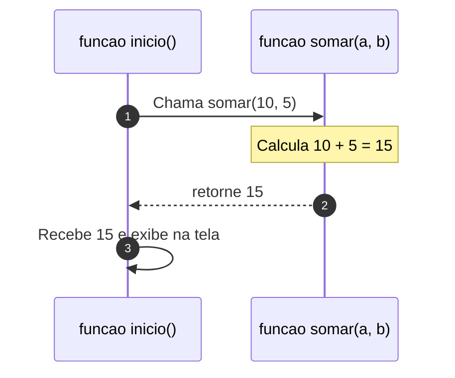

# 🧩 Capítulo 10: Funções, Escopo de Variáveis & Bibliotecas

| ⬅️ [Anterior: Matrizes](09-matrizes-tabelas-bidimensionais.md) | 🏠 [Início](../README.md) | ⚡ [Guia Rápido](../guia-rapido-portugol.md) | ➡️ [Próximo: Projeto Final Integrador](11-projeto-final-integrador.md) |
| :--- | :---: | :---: | ---: |

---

## 📋 Informações do Capítulo
- **Tempo estimado de estudo:** 80 minutos
- **Pré-requisitos:** [Capítulo 08](08-vetores-listas-unidimensionais.md).
- **Objetivos de Aprendizagem:**
  1. Compreender o princípio "Dividir para Conquistar" (Modularização).
  2. Criar funções sem retorno (`vazio`) para tarefas repetitivas de tela.
  3. Criar funções com retorno de valores e passagem de parâmetros.
  4. Entender o **Escopo de Variáveis** (variáveis locais vs. globais).
  5. Utilizar as bibliotecas nativas do Portugol (`Util`, `Matematica`, `Texto`).

---

## 🥤 1. Analogia do Mundo Real: O Liquidificador

Pense em um liquidificador de cozinha:
1. **Entrada (Parâmetros):** Você coloca morango, leite e açúcar.
2. **Processamento (Corpo da Função):** Você aperta o botão e as lâminas batem tudo por 1 minuto.
3. **Saída (Retorno):** Ele te devolve uma vitamina pronta para beber!

Uma **Função** na programação é exatamente como esse eletrodoméstico:
- Um bloco isolado de código com uma tarefa específica.
- Você pode chamá-la quantas vezes quiser, de qualquer lugar do programa, sem precisar reescrever as mesmas linhas!



---

## 🛠️ 2. Criando Sua Primeira Função

As funções ficam escritas **dentro do bloco `programa`**, no mesmo nível da `funcao inicio()`:

```portugol
programa {

    // 1. Função sem retorno (apenas executa uma ação na tela)
    funcao desenharCabecalho() {
        escreva("=========================================\n")
        escreva("         SISTEMA PORTUGOL v2.0           \n")
        escreva("=========================================\n")
    }

    // 2. A função principal inicio chama a outra função
    funcao inicio() {
        desenharCabecalho() // Chamada da função!
        escreva("Executando tarefas do sistema...\n")
        desenharCabecalho() // Reutilizando sem reescrever código!
    }
}
```

---

## 📤 3. Funções com Parâmetros e Retorno

Quando uma função precisa calcular algo e **devolver uma resposta**, indicamos o tipo do retorno antes do nome da função e usamos a palavra-chave **`retorne`**:

```portugol
programa {

    // Função que recebe dois números reais e RETORNA a média real
    funcao real calcularMedia(real n1, real n2) {
        real resultado = (n1 + n2) / 2.0
        retorne resultado // Devolve o valor para quem chamou
    }

    funcao inicio() {
        real m1 = calcularMedia(8.0, 9.0)
        real m2 = calcularMedia(5.0, 7.0)

        escreva("Média do aluno 1: ", m1, "\n")
        escreva("Média do aluno 2: ", m2, "\n")
    }
}
```

---

## 🌐 4. O Escopo de Variáveis (Locais vs Globais)

> [!IMPORTANT]
> - **Variável Local:** Criada dentro de uma função. Ela só existe e só pode ser usada dentro daquela função. Quando a função termina, a variável é destruída da memória.
> - **Variável Global:** Criada fora de todas as funções (direto no bloco `programa`). Ela é visível e pode ser acessada por qualquer função do código.

```portugol
programa {
    cadeia versao = "1.0" // Variável GLOBAL (todos enxergam)

    funcao teste() {
        inteiro x = 10 // Variável LOCAL (só o teste enxerga)
    }

    funcao inicio() {
        // x = 20 // ERRO! A função inicio não sabe quem é x!
    }
}
```

---

## 📚 5. Usando as Bibliotecas do Portugol Webstudio

O Portugol já vem com "superpoderes" prontos para usar. Basta incluir a biblioteca no topo:

```portugol
programa {
    // Importando e dando um apelido curto
    inclua biblioteca Util --> u
    inclua biblioteca Matematica --> mat

    funcao inicio() {
        // Gerando números aleatórios
        inteiro sorteado = u.sorteia(1, 100)
        escreva("Número sorteado: ", sorteado, "\n")

        // Pausando a tela por 2 segundos (2000 milissegundos)
        escreva("Aguarde 2 segundos...\n")
        u.aguarde(2000)

        // Raiz quadrada e potências
        real raiz = mat.raiz(49.0, 2.0)
        escreva("Raiz quadrada de 49: ", raiz, "\n")
    }
}
```

---

## 🔍 6. Teste de Mesa Guiado

Acompanhando a chamada de função:

```portugol
funcao inteiro dobro(inteiro n) {
    retorne n * 2
}
funcao inicio() {
    inteiro res = dobro(7)
}
```

| Etapa | Fluxo do Computador | Estado da Memória |
| :---: | :--- | :--- |
| **1** | `inicio()` chama `dobro(7)` | Pausa `inicio()`. Entra em `dobro`. |
| **2** | Parâmetro `n` recebe o valor `7` | `n = 7` no escopo de `dobro` |
| **3** | `retorne n * 2` calcula `14` | Devolve `14` e encerra `dobro` |
| **4** | `inicio()` retoma na linha da chamada | `res = 14` |

---

## ⚠️ 7. Erros Comuns

1. **Esquecer o `retorne`:** Se você declarou `funcao inteiro somar()`, é obrigatório ter um `retorne numero` no final do bloco.
2. **Incompatibilidade de Parâmetros:** Se a função espera dois parâmetros `funcao teste(inteiro a, cadeia b)`, chamá-la com `teste(10)` (faltando um) causará erro de compilação.

---

## 🏋️ 8. Laboratório de Atividades Práticas

---

### 🟢 Atividade 1 (Fixação): Divisor de Linhas Personalizado
Crie uma função sem retorno chamada `imprimirSeparador(caracter simbolo, inteiro tamanho)`. Quando chamada com `imprimirSeparador('-', 30)`, ela deve imprimir 30 traços na tela usando um laço `para`. Teste-a na função `inicio()`.

<details>
<summary>💡 Dica</summary>

Use um laço `para (inteiro i = 1; i <= tamanho; i++) escreva(simbolo)`.
</details>

<details>
<summary>✅ Ver Solução Comentada</summary>

```portugol
programa {

    funcao imprimirSeparador(caracter simbolo, inteiro tamanho) {
        para (inteiro i = 1; i <= tamanho; i++) {
            escreva(simbolo)
        }
        escreva("\n")
    }

    funcao inicio() {
        imprimirSeparador('=', 40)
        escreva("        RELATÓRIO FINANCEIRO            \n")
        imprimirSeparador('=', 40)
        escreva("Receitas: R$ 5.000,00\n")
        escreva("Despesas: R$ 2.300,00\n")
        imprimirSeparador('-', 40)
    }
}
```
</details>

---

### 🟢 Atividade 2 (Fixação): Calculadora de Área de Retângulo
Crie uma função com retorno do tipo `real` chamada `calcularArea(real largura, real comprimento)`.
A função deve calcular e retornar `largura * comprimento`.
Na função `inicio()`, leia as dimensões de um terreno e mostre a área calculada.

<details>
<summary>💡 Dica</summary>

Declare a função como `funcao real calcularArea(real l, real c)`.
</details>

<details>
<summary>✅ Ver Solução Comentada</summary>

```portugol
programa {

    funcao real calcularArea(real largura, real comprimento) {
        real area = largura * comprimento
        retorne area
    }

    funcao inicio() {
        real l, c, areaTotal

        escreva("Digite a largura do terreno (m): ")
        leia(l)
        escreva("Digite o comprimento do terreno (m): ")
        leia(c)

        areaTotal = calcularArea(l, c)

        escreva("\nA área total do terreno é: ", areaTotal, " m²\n")
    }
}
```
</details>

---

### 🟡 Atividade 3 (Prática Contextualizada): Conversor de Temperatura com Funções
Crie um programa com duas funções:
1. `celsiusParaFahrenheit(real c)` $\rightarrow$ retorna $F = (c \times 1.8) + 32$.
2. `fahrenheitParaCelsius(real f)` $\rightarrow$ retorna $C = (f - 32) / 1.8$.
No `inicio()`, ofereça um menu para o usuário escolher o tipo de conversão e use as funções criadas.

<details>
<summary>💡 Dica</summary>

Chame cada função de acordo com a opção escolhida no menu.
</details>

<details>
<summary>✅ Ver Solução Comentada</summary>

```portugol
programa {

    funcao real celsiusParaFahrenheit(real c) {
        retorne (c * 1.8) + 32.0
    }

    funcao real fahrenheitParaCelsius(real f) {
        retorne (f - 32.0) / 1.8
    }

    funcao inicio() {
        inteiro opcao
        real temp, convertida

        escreva("1 - Celsius para Fahrenheit\n")
        escreva("2 - Fahrenheit para Celsius\n")
        escreva("Escolha: ")
        leia(opcao)

        escreva("Digite a temperatura: ")
        leia(temp)

        se (opcao == 1) {
            convertida = celsiusParaFahrenheit(temp)
            escreva(temp, " °C = ", convertida, " °F\n")
        } senao se (opcao == 2) {
            convertida = fahrenheitParaCelsius(temp)
            escreva(temp, " °F = ", convertida, " °C\n")
        } senao {
            escreva("Opção inválida!\n")
        }
    }
}
```
</details>

---

### 🟡 Atividade 4 (Prática Contextualizada): Rolagem de Dados de RPG (D20)
Usando a biblioteca `Util`:
Crie uma função `rolarD20()` que sorteia um número entre 1 e 20 com `u.sorteia(1, 20)`.
Adicione um efeito de suspense com `u.aguarde(1000)` simulando os dados girando.
Se o resultado for `20`, exiba `"ACERTO CRÍTICO! ⚔️"`. Se for `1`, exiba `"FALHA CRÍTICA! 💀"`.

<details>
<summary>💡 Dica</summary>

Lembre-se de colocar `inclua biblioteca Util --> u` no início.
</details>

<details>
<summary>✅ Ver Solução Comentada</summary>

```portugol
programa {
    inclua biblioteca Util --> u

    funcao inteiro rolarD20() {
        escreva("🎲 Rolando o dado D20...\n")
        u.aguarde(1200) // Pausa de 1.2 segundos para suspense
        retorne u.sorteia(1, 20)
    }

    funcao inicio() {
        inteiro resultado = rolarD20()

        escreva("Resultado obtido: [", resultado, "]\n")

        se (resultado == 20) {
            escreva("💥 ACERTO CRÍTICO EXTRAORDINÁRIO! O monstro foi derrotado!\n")
        } senao se (resultado == 1) {
            escreva("💀 FALHA CRÍTICA CATASTRÓFICA! Sua espada quebrou!\n")
        } senao se (resultado >= 12) {
            escreva("Sucesso no ataque!\n")
        } senao {
            escreva("Você errou o golpe.\n")
        }
    }
}
```
</details>

---

### 🐛 Atividade 5 (Caça-Bugs): O Erro de Escopo e Retorno Esquecido
Identifique os dois erros grotescos no código a seguir:

```portugol
// CÓDIGO COM ERRO:
programa {
    funcao real calcularDobro(real num) {
        real dobro = num * 2.0
        // Erro 1: onde está o comando retorne?
    }

    funcao inicio() {
        real n = 15.0
        calcularDobro(n)
        // Erro 2: a variável 'dobro' não existe dentro da funcao inicio!
        escreva("O dobro é: ", dobro)
    }
}
```

<details>
<summary>💡 Dica</summary>

A função precisa devolver o valor com `retorne`, e `inicio()` precisa guardar o retorno em uma variável própria.
</details>

<details>
<summary>✅ Ver Solução Comentada</summary>

```portugol
// CÓDIGO CORRIGIDO:
programa {
    funcao real calcularDobro(real num) {
        real dobro = num * 2.0
        retorne dobro // Correção 1: Devolve o valor calculado
    }

    funcao inicio() {
        real n = 15.0
        real resultado // Correção 2: Guarda na variável local de inicio()
        resultado = calcularDobro(n)
        escreva("O dobro é: ", resultado, "\n")
    }
}
```
</details>

---

### 🔴 Atividade 6 (Desafio): Validador de Login e Senha Modularizado
Crie um sistema modularizado com duas funções lógicas separadas:
1. `funcao logico autenticarUsuario(cadeia u)`: Retorna `verdadeiro` se o usuário for `"admin"`.
2. `funcao logico autenticarSenha(cadeia s)`: Retorna `verdadeiro` se a senha for `"12345"`.
Na função `inicio()`, leia as credenciais e use as duas funções combinadas com o operador `e` para conceder ou negar o acesso.

<details>
<summary>💡 Dica</summary>

No `inicio()`, faça: `se (autenticarUsuario(user) == verdadeiro e autenticarSenha(pass) == verdadeiro)`.
</details>

<details>
<summary>✅ Ver Solução Comentada</summary>

```portugol
programa {

    funcao logico autenticarUsuario(cadeia usuario) {
        retorne (usuario == "admin")
    }

    funcao logico autenticarSenha(cadeia senha) {
        retorne (senha == "12345")
    }

    funcao inicio() {
        cadeia user, pass
        logico userOk, passOk

        escreva("=== SISTEMA DE ACESSO RESTRITO ===\n")
        escreva("Usuário: ")
        leia(user)

        escreva("Senha: ")
        leia(pass)

        userOk = autenticarUsuario(user)
        passOk = autenticarSenha(pass)

        se (userOk e passOk) {
            escreva("\n🔓 ACESSO AUTORIZADO! Seja bem-vindo, Administrador.\n")
        } senao {
            escreva("\n🚫 ACESSO RECUSADO! Usuário ou senha incorretos.\n")
        }
    }
}
```
</details>

---

## 🎯 Autoavaliação do Capítulo 10

- [ ] Sei criar funções com e sem parâmetros.
- [ ] Entendo como usar `retorne` para devolver resultados.
- [ ] Entendo a diferença entre variáveis locais e variáveis globais.
- [ ] Sei importar e utilizar bibliotecas como `Util` e `Matematica`.

---

| ⬅️ [Anterior: Matrizes](09-matrizes-tabelas-bidimensionais.md) | 🏠 [Início](../README.md) | ⚡ [Guia Rápido](../guia-rapido-portugol.md) | ➡️ [Próximo: Projeto Final Integrador](11-projeto-final-integrador.md) |
| :--- | :---: | :---: | ---: |
