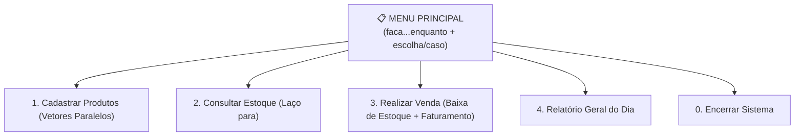
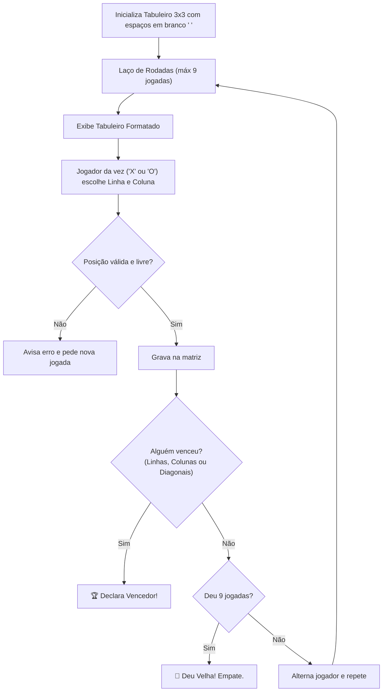

# 🏆 Capítulo 11: Projeto Final Integrador

| ⬅️ [Anterior: Funções e Bibliotecas](10-funcoes-escopo-e-bibliotecas.md) | 🏠 [Início](../README.md) | ⚡ [Guia Rápido](../guia-rapido-portugol.md) |
| :--- | :---: | ---: |

---

## 🎓 Parabéns! Você Chegou ao Topo da Trilha!

Se você chegou até aqui cumprindo os exercícios anteriores, você não é mais um curioso: **você agora domina a base universal da Lógica de Programação**!

Neste capítulo de coroação, você integrará absolutamente **tudo** o que aprendeu:
- ✅ Entrada e Saída formatadas (`leia` e `escreva`)
- ✅ Variáveis e Tipos primitivos
- ✅ Cálculos matemáticos e operadores lógicos
- ✅ Tomadas de decisão (`se / senao` e `escolha / caso`)
- ✅ Estruturas de repetição (`para` e `enquanto`)
- ✅ Vetores e Matrizes
- ✅ Modularização com Funções e Bibliotecas

Abaixo, você tem dois projetos práticos completos de nível de portfólio. Desenvolva-os passo a passo seguindo as missões!

---

## 📦 PROJETO 1: Mini-PDV e Controle de Estoque Comercial

Um sistema completo de frente de caixa e estoque para microempresas, rodando direto no console.



### 🎯 Missões do Projeto 1:
- **Missão 1:** Crie vetores paralelos para 5 produtos:
  - `cadeia nomes[5]`
  - `inteiro quantidades[5]`
  - `real precos[5]`
- **Missão 2:** Crie a função `exibirMenu()` e mantenha o sistema rodando com `faca ... enquanto (opcao != 0)`.
- **Missão 3:** Implemente a função `listarProdutos()` para exibir uma tabela com Código, Nome, Qtd em Estoque e Preço.
- **Missão 4:** Implemente a função de venda: o cliente informa o código do produto e a quantidade. O sistema valida se há estoque suficiente, diminui a quantidade e acumula o faturamento total!

<details>
<summary>👀 Ver Código Completo do Projeto 1 (Mini-PDV)</summary>

```portugol
programa {
    // Variáveis Globais de Estoque (Capacidade: 5 produtos)
    const inteiro TAM = 5
    cadeia nomes[TAM] = {"Café Tradicional", "Açúcar 1kg", "Leite Integral", "Biscoito Recheado", "Pão Francês (kg)"}
    inteiro estoque[TAM] = {20, 15, 30, 25, 10}
    real precos[TAM] = {14.50, 4.20, 5.80, 3.50, 12.00}
    real faturamentoTotal = 0.0

    // Função para desenhar linhas decorativas
    funcao linha() {
        escreva("------------------------------------------------------------\n")
    }

    // Função para listar todos os produtos cadastrados
    funcao listarEstoque() {
        linha()
        escreva("CÓD\tPRODUTO\t\t\tESTOQUE\t\tPREÇO UNIT.\n")
        linha()
        para (inteiro i = 0; i < TAM; i++) {
            escreva("[", i, "]\t", nomes[i], "\t\t", estoque[i], " un\t\tR$ ", precos[i], "\n")
        }
        linha()
    }

    // Função para processar uma venda
    funcao realizarVenda() {
        inteiro cod, qtdDesejada
        real subtotal

        listarEstoque()
        escreva("Digite o código do produto desejado (0 a 4): ")
        leia(cod)

        se (cod < 0 ou cod >= TAM) {
            escreva("❌ Código de produto inválido!\n")
            retorne
        }

        escreva("Quantidade desejada de [", nomes[cod], "]: ")
        leia(qtdDesejada)

        se (qtdDesejada <= 0) {
            escreva("❌ Quantidade deve ser maior que zero!\n")
        } senao se (qtdDesejada > estoque[cod]) {
            escreva("⚠️ ESTOQUE INSUFICIENTE! Temos apenas ", estoque[cod], " unidades disponíveis.\n")
        } senao {
            // Sucesso na venda: calcula valores e atualiza estoque
            estoque[cod] = estoque[cod] - qtdDesejada
            subtotal = qtdDesejada * precos[cod]
            faturamentoTotal = faturamentoTotal + subtotal

            escreva("\n✅ VENDA CONFIRMADA COM SUCESSO!\n")
            escreva("Item: ", nomes[cod], " | Qtd: ", qtdDesejada, "\n")
            escreva("Subtotal a pagar: R$ ", subtotal, "\n")
        }
    }

    funcao inicio() {
        inteiro opcao

        faca {
            linha()
            escreva("           SISTEMA DE CONTROLE DE ESTOQUE & PDV             \n")
            linha()
            escreva("  [1] Consultar Tabela de Estoque\n")
            escreva("  [2] Realizar Venda de Produto\n")
            escreva("  [3] Relatório de Faturamento do Dia\n")
            escreva("  [0] Encerrar o Sistema\n")
            linha()
            escreva("Escolha uma opção: ")
            leia(opcao)

            escolha (opcao) {
                caso 1:
                    listarEstoque()
                    pare
                caso 2:
                    realizarVenda()
                    pare
                caso 3:
                    linha()
                    escreva("💰 FATURAMENTO ACUMULADO HOJE: R$ ", faturamentoTotal, "\n")
                    linha()
                    pare
                caso 0:
                    escreva("\nEncerrando sistema... Obrigado pelo trabalho!\n")
                    pare
                caso contrario:
                    escreva("Opção inválida! Tente novamente.\n")
            }
            escreva("\n")
        } enquanto (opcao != 0)
    }
}
```
</details>

---

## 🎮 PROJETO 2: O Clássico Jogo da Velha (Console)

Um jogo interativo para dois jogadores disputarem rodada a rodada em um tabuleiro $3 \times 3$ feito com Matriz.



### 🎯 Missões do Projeto 2:
- **Missão 1:** Crie uma matriz `caracter tabuleiro[3][3]` e preencha com o caractere de espaço `' '`.
- **Missão 2:** Crie a função `desenharTabuleiro()` para exibir a grade com separadores `|` e `---`.
- **Missão 3:** Crie uma função para verificar se houve vitória em qualquer uma das 3 linhas, 3 colunas ou 2 diagonais.
- **Missão 4:** Crie o laço principal que alterna as peças `'X'` e `'O'` até haver um vencedor ou empate ("velha").

<details>
<summary>👀 Ver Código Completo do Projeto 2 (Jogo da Velha)</summary>

```portugol
programa {
    caracter tab[3][3]

    // Inicializa a matriz com espaços vazios
    funcao inicializarTabuleiro() {
        para (inteiro l = 0; l < 3; l++) {
            para (inteiro c = 0; c < 3; c++) {
                tab[l][c] = ' '
            }
        }
    }

    // Desenha o tabuleiro no console
    funcao desenharTabuleiro() {
        escreva("\n     0   1   2  (Colunas)\n")
        para (inteiro l = 0; l < 3; l++) {
            escreva(" ", l, "   ", tab[l][0], " | ", tab[l][1], " | ", tab[l][2], "\n")
            se (l < 2) {
                escreva("    ---+---+---\n")
            }
        }
        escreva("\n")
    }

    // Checa se o jogador atual venceu
    funcao logico checarVitoria(caracter p) {
        // Checando as 3 linhas horizontais
        para (inteiro l = 0; l < 3; l++) {
            se (tab[l][0] == p e tab[l][1] == p e tab[l][2] == p) {
                retorne verdadeiro
            }
        }

        // Checando as 3 colunas verticais
        para (inteiro c = 0; c < 3; c++) {
            se (tab[0][c] == p e tab[1][c] == p e tab[2][c] == p) {
                retorne verdadeiro
            }
        }

        // Checando Diagonal Principal
        se (tab[0][0] == p e tab[1][1] == p e tab[2][2] == p) {
            retorne verdadeiro
        }

        // Checando Diagonal Secundária
        se (tab[0][2] == p e tab[1][1] == p e tab[2][0] == p) {
            retorne verdadeiro
        }

        retorne falso
    }

    funcao inicio() {
        caracter jogadorAtual = 'X'
        inteiro lin, col
        inteiro jogadas = 0
        logico venceu = falso

        inicializarTabuleiro()

        escreva("=========================================\n")
        escreva("          JOGO DA VELHA PORTUGOL         \n")
        escreva("=========================================\n")

        enquanto (jogadas < 9 e venceu == falso) {
            desenharTabuleiro()
            escreva("Vez do Jogador [", jogadorAtual, "]:\n")
            escreva("Informe a Linha (0 a 2): ")
            leia(lin)
            escreva("Informe a Coluna (0 a 2): ")
            leia(col)

            se (lin < 0 ou lin > 2 ou col < 0 ou col > 2) {
                escreva("⚠️ Coordenada inválida! Digite valores entre 0 e 2.\n")
            } senao se (tab[lin][col] != ' ') {
                escreva("⚠️ Posição já preenchida! Escolha uma casa vazia.\n")
            } senao {
                // Jogada válida: grava no tabuleiro
                tab[lin][col] = jogadorAtual
                jogadas++

                // Verifica se venceu
                se (checarVitoria(jogadorAtual)) {
                    venceu = verdadeiro
                } senao {
                    // Alterna o jogador
                    se (jogadorAtual == 'X') {
                        jogadorAtual = 'O'
                    } senao {
                        jogadorAtual = 'X'
                    }
                }
            }
        }

        desenharTabuleiro()

        se (venceu == verdadeiro) {
            escreva("🎉 PARABÉNS! O Jogador [", jogadorAtual, "] VENCEU A PARTIDA!\n")
        } senao {
            escreva("🤝 DEU VELHA! A partida terminou empatada.\n")
        }
    }
}
```
</details>

---

## 🌟 Para Onde Ir Agora? (Seus Próximos Passos)

Agora que sua lógica de programação está afiada e você domina o raciocínio algorítmico, a transição para qualquer linguagem de mercado será extremamente simples!

Aqui está o mapa de transição do Portugol para linguagens reais:

| Conceito no Portugol | Em Python | Em JavaScript | Em C / C++ |
| :--- | :--- | :--- | :--- |
| `escreva("Oi")` | `print("Oi")` | `console.log("Oi")` | `printf("Oi");` |
| `leia(x)` | `x = input()` | `prompt()` | `scanf("%d", &x);` |
| `se (x > 0) { }` | `if x > 0:` | `if (x > 0) { }` | `if (x > 0) { }` |
| `para (i=0; i<10; i++)`| `for i in range(10):`| `for (let i=0; i<10; i++)` | `for (int i=0; i<10; i++)` |
| `vetor[5]` | `lista = [0]*5` | `const array = []` | `int vetor[5];` |
| `funcao inicio()` | `def main():` | `function main() { }` | `int main() { }` |

> [!TIP]
> **Recomendação para continuar seus estudos:**
> 1. Se você gosta de **Criação de Sites e Interfaces**: Aprenda **JavaScript**.
> 2. Se você quer **Inteligência Artificial, Automação e Ciência de Dados**: Aprenda **Python**.
> 3. Se você busca **Games e Alto Desempenho**: Aprenda **C#** ou **C++**.

Parabéns por completar toda a trilha! Salve este repositório nos seus favoritos ⭐ no GitHub e compartilhe seu progresso!

---

| ⬅️ [Anterior: Funções e Bibliotecas](10-funcoes-escopo-e-bibliotecas.md) | 🏠 [Início](../README.md) | ⚡ [Guia Rápido](../guia-rapido-portugol.md) |
| :--- | :---: | ---: |

